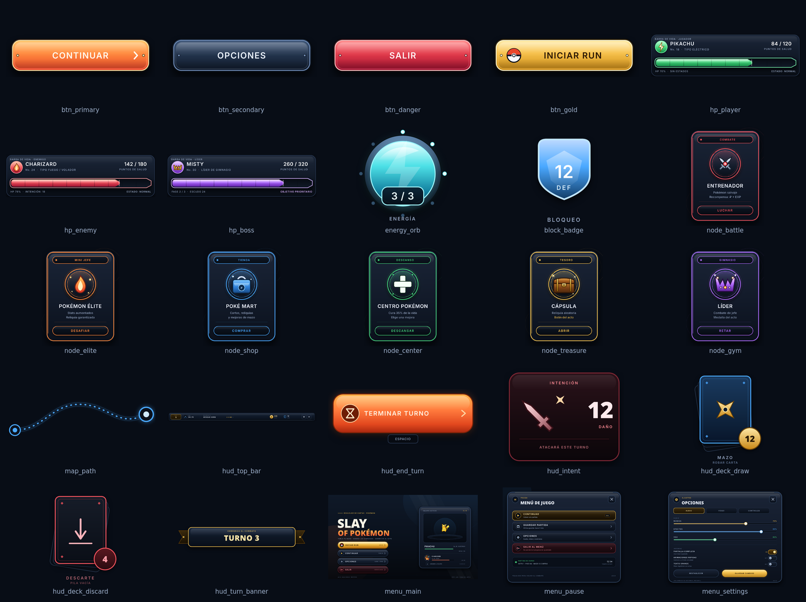
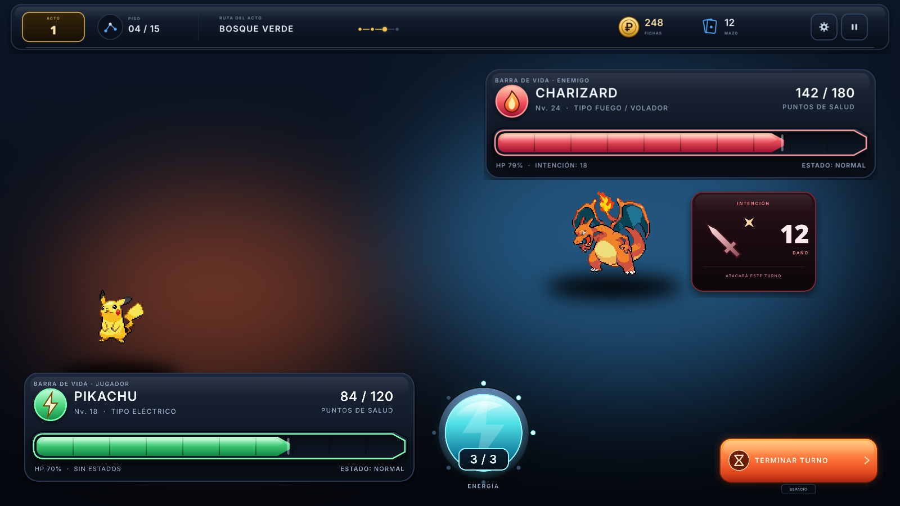

# Kit de UI — Slay of Pokémon

Assets vectoriales creados con **VectorCraft 0.18.0** para menús, combate, mapa y HUD.
Cada categoría incluye:

- PNG exportado a **2×** con fondo transparente.
- SVG con textos convertidos a contornos (no depende de fuentes instaladas).
- Master editable `.vectorcraft`.
- Batch `.commands.json` para regenerar todo con el CLI de VectorCraft.



### Mockup de combate

Composición de referencia con las piezas del kit y los sprites del juego:



El mockup es una composición PNG para previsualizar la integración; las piezas individuales siguen siendo vectoriales y editables.

---

## 1. Inventario

### Botones — `assets/ui/buttons/`

Arte de 440×128 lógico (PNG 880×256). El botón ocupa 400×88 con 20 px de margen.

| Archivo | Estado / uso |
|---|---|
| `btn_primary` | CTA principal naranja, texto “CONTINUAR” |
| `btn_primary_hover` | Hover con borde y glow reforzados |
| `btn_primary_pressed` | Presionado, contenido desplazado 4 px |
| `btn_secondary` | Acción secundaria acero azul, “OPCIONES” |
| `btn_danger` | Acción destructiva roja, “SALIR” |
| `btn_gold` | CTA dorado con Pokéball, “INICIAR RUN” |
| `btn_disabled` | Estado bloqueado desaturado, “BLOQUEADO” |
| `btn_icon` | Botón cuadrado 128×128 con engranaje |

### Barras y medidores — `assets/ui/bars/`

| Archivo | Tamaño lógico | Uso |
|---|---:|---|
| `hp_player` | 700×200 | Tarjeta completa de referencia: Pikachu, 84/120 |
| `hp_enemy` | 700×200 | Tarjeta completa de referencia: Charizard, 142/180 |
| `hp_boss` | 700×200 | Tarjeta de jefe: Misty, 260/320 |
| `hp_bar_bg` | 700×80 | Marco vacío + marcas cada 10 % |
| `hp_fill_player` | 700×80 | Relleno verde estirable/recortable |
| `hp_fill_enemy` | 700×80 | Relleno rojo estirable/recortable |
| `hp_fill_boss` | 700×80 | Relleno violeta estirable/recortable |
| `energy_orb` | 200×210 | Orbe de energía 3/3 con anillo metálico |
| `block_badge` | 160×180 | Escudo de bloqueo 12 DEF |

Para una barra dinámica usa `hp_bar_bg` + `hp_fill_*`; las tarjetas completas son mockups con nombres y números ya dibujados.

### Nodos del mapa — `assets/ui/nodes/`

Tarjetas de 280×360 lógico y conectores.

| Archivo | Tipo | Acento |
|---|---|---|
| `node_battle` | Combate / entrenador | Rojo `#f0525c` |
| `node_elite` | Mini jefe | Naranja `#ff8a3d` |
| `node_shop` | Poké Mart | Azul `#4aa8ff` |
| `node_center` | Centro Pokémon | Verde `#45d47c` |
| `node_treasure` | Cápsula / tesoro | Dorado `#f2c14e` |
| `node_gym` | Gimnasio / líder | Violeta `#b06bff` |
| `map_path` | Conector 360×120 | Azul |

### Menús — `assets/ui/menus/`

| Archivo | Tamaño lógico | Contenido |
|---|---:|---|
| `menu_main` | 1280×720 | Pantalla de inicio, título, 4 acciones, panel de equipo con sprites |
| `menu_pause` | 760×620 | Modal de pausa con 4 filas y tarjeta de partida |
| `menu_settings` | 760×620 | Opciones de audio, vídeo y controles |

### HUD — `assets/ui/hud/`

| Archivo | Tamaño lógico | Uso |
|---|---:|---|
| `hud_top_bar` | 1600×96 | Acto, piso, ruta, fichas, mazo, ajustes y pausa |
| `hud_end_turn` | 300×112 | Botón “TERMINAR TURNO” + atajo ESPACIO |
| `hud_deck_draw` | 200×220 | Mazo de robo con contador |
| `hud_deck_discard` | 200×220 | Pila de descarte con contador |
| `hud_intent` | 240×200 | Intención enemiga: 12 de daño |
| `hud_turn_banner` | 560×120 | Banner “TURNO 3” / inicio de combate |

---

## 2. Paleta

| Rol | Hex |
|---|---|
| Fondo profundo | `#070a10` / `#0b1019` |
| Panel | `#0f1622` / `#141d2c` |
| Panel elevado | `#1d293d` |
| Borde | `#2a3a55` / `#3b4d6b` |
| Texto | `#eef3ff` |
| Texto atenuado | `#93a4c0` |
| Primario | `#ff7a3d` |
| Primario claro | `#ffb347` |
| Primario profundo | `#e23b2b` |
| Dorado | `#f2c14e` / `#ffe08a` |
| Azul | `#4aa8ff` |
| Cian | `#4de0e6` |
| Verde | `#45d47c` |
| Rojo | `#f0525c` |
| Violeta | `#b06bff` |
| Naranja | `#ff8a3d` |

Tipografía de los mockups: **Inter SemiBold / Medium** para etiquetas y **Noto Sans Black** para títulos. En el juego se puede reutilizar `assets/fonts/FiraSans-Bold.ttf` o añadir Inter/Noto.

---

## 3. Uso en Bevy

Las rutas de `AssetServer` son relativas a `assets/`, por ejemplo:

```rust
let btn = asset_server.load("ui/buttons/btn_primary.png");
let hp_bg = asset_server.load("ui/bars/hp_bar_bg.png");
let hp_fill = asset_server.load("ui/bars/hp_fill_player.png");
```

Los PNG están a 2×. Para que un botón se vea a 400×88 lógico, asígnalo a `width: 400px`, `height: 88px`; Bevy lo reescala. Lo mismo aplica a las tarjetas de 700×200 y a los menús de 1280×720.

Patrón recomendado:

- **Menús completos**: `ImageNode` de fondo + botones invisibles (`Button` + `Interaction`) encima, o reconstruir las filas con `ImageNode` + `Text` si necesitas estados dinámicos.
- **Botones**: `Button` + `ImageNode` usando `btn_primary` / `hover` / `pressed`. Si el texto debe cambiar, usa el master para generar una versión sin texto o superpón un `Text` y deja el botón como marco.
- **Barras de vida**: contenedor con `hp_bar_bg`, dentro un nodo con `hp_fill_*` y `Overflow::clip()`. Ajusta el ancho del relleno al porcentaje de HP y dibuja nombre/números con `Text` aparte.
- **Nodos de mapa**: cada tarjeta es una imagen de fondo; añade `Button`/`Interaction` y un `Text` si los costes o recompensas cambian.
- **HUD**: usa `hud_top_bar`, `hud_end_turn`, etc. como piezas flotantes con posición absoluta. Los textos de los mockups están horneados; para valores dinámicos superpón `Text` sobre las zonas correspondientes o edita el master.

> **Nota:** los textos de botones, nodos, menús y HUD están dibujados dentro del SVG/PNG como parte del diseño. Son perfectos para prototipos y pantallas estáticas. Para producción con valores dinámicos conviene usar las piezas base (fondo de barra, rellenos, marcos) y poner el texto con Bevy.

---

## 4. Regenerar

Requisitos: Node.js y el CLI de VectorCraft. Ejemplo de ruta del CLI:

```bash
VC=/tmp/opencode/vc-extract/squashfs-root/usr/bin/vectorcraft-cli
```

Los generadores viven en `tools/vectorcraft/` y escriben en `assets/ui/`. Desde la raíz del repo:

```bash
node tools/vectorcraft/gen_buttons.js
$VC run --commands assets/ui/buttons/buttons.commands.json

node tools/vectorcraft/gen_bars.js
$VC run --commands assets/ui/bars/bars.commands.json

node tools/vectorcraft/gen_nodes.js
$VC run --commands assets/ui/nodes/nodes.commands.json

node tools/vectorcraft/gen_menus.js
$VC run --commands assets/ui/menus/menus.commands.json

node tools/vectorcraft/gen_hud.js
$VC run --commands assets/ui/hud/hud.commands.json
```

Cada ejecución reescribe el master `.vectorcraft`, el batch `.commands.json`, los PNG a 2× y los SVG. Los masters se pueden abrir y editar directamente en VectorCraft.

Para regenerar la hoja de contacto:

```bash
magick montage -label '%t' \
  assets/ui/buttons/btn_primary.png assets/ui/buttons/btn_secondary.png \
  assets/ui/buttons/btn_danger.png assets/ui/buttons/btn_gold.png \
  assets/ui/bars/hp_player.png assets/ui/bars/hp_enemy.png assets/ui/bars/hp_boss.png \
  assets/ui/bars/energy_orb.png assets/ui/bars/block_badge.png \
  assets/ui/nodes/node_battle.png assets/ui/nodes/node_elite.png assets/ui/nodes/node_shop.png \
  assets/ui/nodes/node_center.png assets/ui/nodes/node_treasure.png assets/ui/nodes/node_gym.png \
  assets/ui/nodes/map_path.png assets/ui/hud/hud_top_bar.png assets/ui/hud/hud_end_turn.png \
  assets/ui/hud/hud_intent.png assets/ui/hud/hud_deck_draw.png assets/ui/hud/hud_deck_discard.png \
  assets/ui/hud/hud_turn_banner.png assets/ui/menus/menu_main.png assets/ui/menus/menu_pause.png \
  assets/ui/menus/menu_settings.png \
  -thumbnail 360x220 -tile 5x -geometry 360x240+14+14 \
  -background '#080d16' -fill '#9fb1cc' -font DejaVu-Sans -pointsize 15 \
  assets/ui/preview_kit.png
```
