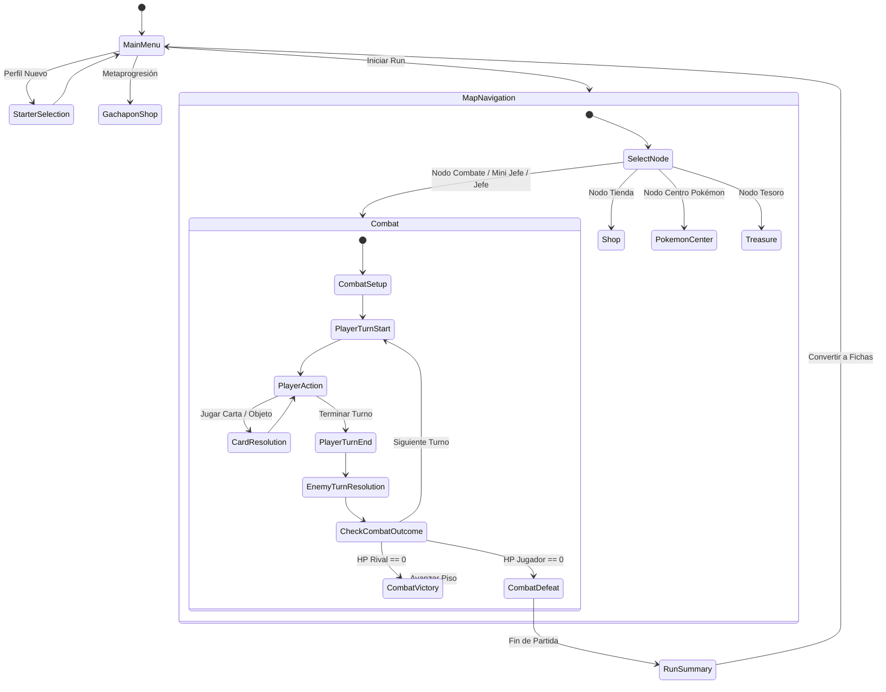

# 🎮 Documento de Diseño de Juego (GDD): SpireMon

**Documento de Especificación Técnica y de Diseño**  
*Versión 1.0 (Provisional)* • Motor: **Rust + Bevy Engine** • Género: **Roguelike Deckbuilder RPG**

---

## 📑 Índice de Contenidos

1. [Visión General (High Concept)](#1-visión-general-high-concept)
2. [Pilares de Diseño](#2-pilares-de-diseño)
3. [Bucle Principal de Jugabilidad (Core Loop)](#3-bucle-principal-de-jugabilidad-core-loop)
4. [Sistema de Combate y Mecánicas de Mazo](#4-sistema-de-combate-y-mecánicas-de-mazo)
   - 4.1 [Estructura del Turno](#41-estructura-del-turno)
   - 4.2 [Pokémon Protagonista Único y Escalado por Estadísticas (Stats RPG)](#42-pokémon-protagonista-único-y-escalado-por-estadísticas-stats-rpg)
   - 4.3 [Sistema de los 18 Tipos Oficiales de Pokémon y Sinergias de Deckbuilding](#43-sistema-de-los-18-tipos-oficiales-de-pokémon-y-sinergias-de-deckbuilding)
5. [Obtención y Mejora de Cartas, Rarezas y Evolución de Pokémon](#5-obtención-y-mejora-de-cartas-rarezas-y-evolución-de-pokémon)
   - 5.1 [Mejora de Cartas (Entrenamiento +)](#51-mejora-de-cartas-entrenamiento-)
   - 5.2 [Tiers de Rareza de Cartas](#52-tiers-de-rareza-de-cartas)
   - 5.3 [Curva de Niveles, Experiencia y Evolución Canónica (Niveles 5 al 55+)](#53-curva-de-niveles-experiencia-y-evolución-canónica-niveles-5-al-55)
   - 5.4 [Estructura del Mazo Inicial (10 Cartas)](#54-estructura-del-mazo-inicial-10-cartas)
   - 5.5 [Sistema de Afinidad de Cartas por Especie (Move Pool) y Bonificación STAB](#55-sistema-de-afinidad-de-cartas-por-especie-move-pool-y-bonificación-stab)
   - 5.6 [Catálogo Maestro de Cartas por Tier de Rareza (30 Cartas Base)](#56-catálogo-maestro-de-cartas-por-tier-de-rareza-30-cartas-base)
6. [Estructura del Mapa Procedural y Nodos](#6-estructura-del-mapa-procedural-y-nodos)
   - 6.1 [Diseño de Encuentros: Enemigos Comunes, Mini Jefes y Jefes de Acto](#61-diseño-de-encuentros-enemigos-comunes-entrenadores-mini-jefes-salvajes-y-jefes-de-acto)
   - 6.2 [Diseño de Jefes de Acto: Los Líderes de Gimnasio y sus Medallas](#62-diseño-de-jefes-de-acto-los-líderes-de-gimnasio-y-sus-medallas)
   - 6.3 [Algoritmo y Reglas de Generación del Mapa Procedural (3 Caminos)](#63-algoritmo-y-reglas-de-generación-del-mapa-procedural-3-caminos)
   - 6.4 [Sistema de Inteligencia Artificial (IA) de Enemigos y Patrones de Intención](#64-sistema-de-inteligencia-artificial-ia-de-enemigos-y-patrones-de-intención)
7. [Economía de Partida, Tienda Pokémon, Tesoros y Objetos Equipables](#7-economía-de-partida-tienda-pokémon-tesoros-y-objetos-equipables)
   - 7.1 [Economía Interna de la Run (Poké-Dólares ₽)](#71-economía-interna-de-la-run-poké-dólares-)
   - 7.2 [Estructura e Inventario de la Tienda Pokémon (Poké Mart)](#72-estructura-e-inventario-de-la-tienda-pokémon-poké-mart)
   - 7.3 [Economía de los Nodos de Tesoro (Cofres / Cápsulas)](#73-economía-de-los-nodos-de-tesoro-cofres--cápsulas)
   - 7.4 [Economía de Metaprogresión (Puntos Gachapón al Final de la Run)](#74-economía-de-metaprogresión-puntos-gachapón-al-final-de-la-run)
   - 7.5 [Catálogo Maestro de Reliquias (Objetos Equipables) y Consumibles](#75-catálogo-maestro-de-reliquias-objetos-equipables-y-consumibles)
8. [Metaprogresión: Tienda Gachapón y Desbloqueo de Pokémon](#8-metaprogresión-tienda-gachapón-y-desbloqueo-de-pokémon)
   - 8.1 [Mecánica de Fragmentos de Pokémon (Potenciador de Tirada en Gachapón)](#81-mecánica-de-fragmentos-de-pokémon-potenciador-de-tirada-en-gachapón)
   - 8.2 [Probabilidades de Aparición (Drop Rates del Gachapón)](#82-probabilidades-de-aparición-drop-rates-del-gachapón)
   - 8.3 [Duplicados y Mejora de Talento (Constelación / IVs)](#83-duplicados-y-mejora-de-talento-constelación--ivs)
   - 8.4 [Niveles de Ascensión (Liga Máster)](#84-niveles-de-ascensión-liga-máster)
9. [Diseño de Interfaz de Usuario (UI/UX) y Flujo de Pantallas](#9-diseño-de-interfaz-de-usuario-uiux-y-flujo-de-pantallas)
   - 9.1 [Pantalla de Combate (HUD Principal)](#91-pantalla-de-combate-hud-principal)
   - 9.2 [Pantalla del Mapa Procedural, Centro Pokémon, Tienda y Gachapón](#92-pantalla-del-mapa-procedural-centro-pokémon-tienda-y-gachapón)
10. [Arquitectura Técnica del Prototipo (Rust + Bevy Engine)](#10-arquitectura-técnica-del-prototipo-rust--bevy-engine)
   - 10.1 [Gestión de Estados del Juego (States en Bevy)](#101-gestión-de-estados-del-juego-states-en-bevy)
   - 10.2 [Diseño ECS (Componentes y Recursos Principales en Rust)](#102-diseño-ecs-componentes-y-recursos-principales-en-rust)
   - 10.3 [Arquitectura Basada en Eventos (Events) para Cartas y Reliquias](#103-arquitectura-basada-en-eventos-events-para-cartas-y-reliquias)
   - 10.4 [Datos Externos (RON / JSON) y Crates Recomendados](#104-datos-externos-ron--json-y-crates-recomendados-para-el-ecosistema-bevy)
11. [Hoja de Ruta para el Prototipo (MVP)](#11-hoja-de-ruta-para-el-prototipo-mvp)

---

## 1. Visión General (High Concept)

* **Género:** Roguelike Deckbuilder por turnos con colección y evolución de criaturas (inspirado en *Slay the Spire* y el universo Pokémon).
* **Plataformas Objetivo:** PC (Steam) y dispositivos móviles / consolas portátiles.
* **Público Objetivo:** Jugadores de estrategia por turnos, fans de los roguelikes de cartas y entusiastas de los RPG de captura de criaturas.
* **Propuesta de Valor Única (USP):**  
  A diferencia de los deckbuilders tradicionales con un héroe genérico, el jugador controla a un **único Pokémon protagonista por partida (run)**.
  
  > [!IMPORTANT]
  > **Selección Permanente de Inicio:** La primera vez que el jugador inicia el juego, elige **1 único Pokémon inicial** de cualquier generación (Gen 1 a Gen 9) como su compañero permanente de inicio. Al tomar esa decisión, únicamente ese starter queda desbloqueado en su plantel inicial, mientras que todos los demás iniciales de todas las generaciones pasan a la reserva del **Gachapón** para ser desbloqueados posteriormente.
  >
  > **Sin Pasivas Innatas / Escalado por Stats:** Los Pokémon **no poseen habilidades pasivas innatas**; esa función la cumplen directamente las **Reliquias Iniciales** (Objetos Equipables) y la fusión de las **Estadísticas Base RPG** (`HP`, `Atk`, `Def`, `Sp. Atk`, `Sp. Def`, `Spe`) con la construcción de mazo. Las cartas no infligen un daño plano fijo, sino que actúan como **multiplicadores de las estadísticas del Pokémon**, haciendo que subir de nivel y evolucionar incremente de forma natural y orgánica la potencia matemática de todo el mazo.

---

## 2. Pilares de Diseño

1. **Fusión de Estadísticas RPG y Deckbuilding:**  
   Las decisiones tácticas giran en torno al uso de cartas cuyos efectos de daño y mitigación se escalan directamente mediante las estadísticas del Pokémon protagonista (`Atk`/`Sp. Atk` para cartas ofensivas, `Def`/`Sp. Def` para Bloqueo y `Spe` para bonificaciones de turno).
2. **Progresión Evolutiva Tangible:**  
   Subir de nivel y evolucionar a una criatura no solo mejora drásticamente sus estadísticas, sino que transforma su mazo base y desbloquea arquetipos avanzados de juego.
3. **Transparencia Táctica Total:**  
   Siguiendo el estándar de oro de *Slay the Spire*, las intenciones del enemigo (ataque, defensa, estado alterado o cambio de criatura) son **100% visibles cada turno**, premiando la planificación y el cálculo estratégico sobre el azar.
4. **Rejugabilidad Infinita:**  
   Mapas ramificados generados proceduralmente, sinergias de reliquias (Objetos Equipables / Medallas de Gimnasio) y un extenso catálogo de especies desbloqueables en la metaprogresión con variantes raras.

---

## 3. Bucle Principal de Jugabilidad (Core Loop)

```mermaid
flowchart TD
    A["Menú Principal / Tienda Gachapón"] --> B["Selección de Pokémon Protagonista Desbloqueado"]
    B --> C["Inicio de Partida: Acto 1 (Nivel 5, Mazo Base 10 cartas)"]
    C --> D["Navegación del Mapa Procedural (3 Caminos Interconectados)"]
    D --> E{"Nodo Seleccionado"}
    E -->|Enemigo Común| F["Combate Entrenador: EXP + Oro (₽) + Carta"]
    E -->|Mini Jefe| G["Combate Pokémon Salvaje: Alta EXP + Reliquia + Fragmento"]
    E -->|Tienda Pokémon| H["Poké Mart: Compra/Venta + Olvidar Movimiento"]
    E -->|Centro Pokémon| I["Descanso: Curar HP o Entrenar Carta (+)"]
    E -->|Tesoro| J["Cápsula Silph: Reliquias + Oro/Cartas"]
    F & G & H & I & J --> K{"¿Piso 15, 30 o 45?"}
    K -->|No| D
    K -->|Piso 15 / 30 / 45| L["Jefe de Acto: Líder de Gimnasio (Combate por Fases)"]
    L --> M["Recompensa: +5 Niveles EXP + Medalla Gimnasio + Carta Alta Rareza"]
    M --> N{"¿Superó Acto 3?"}
    N -->|No: Avanza al siguiente Acto| D
    N -->|Sí (Victoria) / Derrota| O["Fin de Run: Conversión de Desempeño a Fichas Gachapón"]
    O --> A
```

* **Selección Inicial:**  
  La primera vez que se inicia una nueva partida guardada, el jugador elige 1 único Pokémon inicial de cualquier generación (Gen 1 a Gen 9) como su compañero inicial permanente. Solo ese Pokémon queda desbloqueado en su plantel, mientras que los demás iniciales se trasladan al catálogo del Gachapón. Para cada partida (run), el jugador elige 1 Pokémon protagonista de su catálogo de desbloqueados, lo cual define sus estadísticas base, afinidad elemental y mazo de inicio. Los Pokémon no poseen habilidades pasivas innatas; esta función recae en las Reliquias Iniciales equipadas.
* **Navegación del Mapa:**  
  Ascenso a través de una ruta ramificada dividida en **3 Actos** (Bosque Primigenio, Cueva Volcánica / Ruinas Industriales y Cumbre de la Liga).
* **Encuentros y Eventos:**  
  Navegación a través de 5 tipos de nodos procedurales: combates contra **Enemigo Común** (Entrenadores Clásicos como Montañero, Chica, Escolar, Cazabichos, Nadador, etc.) o **Mini Jefe** (poderosos Pokémon Salvajes), apertura de cofres de **Tesoro**, visitas a la **Tienda** y paradas estratégicas en el **Centro Pokémon**.
* **Recompensa y Construcción del Mazo:**  
  Tras superar encuentros de combate, el jugador obtiene **Experiencia (EXP)** para subir de nivel al Pokémon y mejorar sus estadísticas base, **Oro (₽)** para la Tienda, cartas categorizadas en **5 tiers de rareza** (Común, Poco Común, Raro, Exótico y Legendario), **Puntos de Metaprogresión** al finalizar la partida para la Tienda Gachapón, y al derrotar a un Mini Jefe obtiene de forma permanente **1 Fragmento** de ese Pokémon, el cual se puede utilizar en el menú del Gachapón para potenciar la probabilidad de obtención de dicha especie en una tirada individual.
* **Jefe de Acto y Evolución:**  
  La evolución ocurre strictly al alcanzar el nivel requerido por el Pokémon. Al final de cada Acto, el jugador se enfrenta a un **Líder de Gimnasio**. Derrotarlo otorga 5 niveles de EXP, una **Medalla de Gimnasio** (que funciona como una poderosa Reliquia de Jefe / Boss Relic) y una carta de alta rareza garantizada (Raro/Exótico/Legendario).

---

## 4. Sistema de Combate y Mecánicas de Mazo

### 4.1 Estructura del Turno

1. **Inicio del Turno del Jugador:**  
   * Se restauran los Puntos de Energía (base: **3 de Energía** por turno).
   * Se disipa el Bloqueo acumulado del turno anterior (a menos que se posean cartas o reliquias de retención).
   * Se roban **5 cartas** de la pila de extracción (Draw Pile).
2. **Fase de Acción:**  
   * El jugador juega cartas de Ataque, Habilidad (Defensa/Utilidad) o Poder (Pasivas de combate permanente) consumiendo Energía.
   * Utiliza Objetos Consumibles (Pociones/Bayas) de su cinturón (coste 0 de Energía).
3. **Fin del Turno y Turno Enemigo:**  
   * Las cartas no jugadas restantes van a la pila de descarte (salvo cartas con efecto de retención).
   * Los enemigos ejecutan exactamente la **intención anunciada** sobre su cabeza (Ataque, Bloqueo, Buff, Debuff o cambio de estado).

---

### 4.2 Pokémon Protagonista Único y Escalado por Estadísticas (Stats RPG)

El juego utiliza una arquitectura de Pokémon Protagonista Único combinada con las estadísticas clásicas de Pokémon, donde subir de nivel y evolucionar impacta directamente la potencia matemática de todas las cartas del mazo.

> [!NOTE]
> **Filosofía de Pasivas:** Los Pokémon no poseen habilidades pasivas innatas; en su lugar, la personalización táctica proviene de las **Reliquias Iniciales** y del crecimiento numérico de sus estadísticas base.

#### Estadísticas Base del Pokémon
Cada Pokémon posee sus estadísticas base fieles a su arquetipo (que crecen automáticamente al subir de nivel y dan un salto importante al evolucionar):
* **`HP` (Puntos de Salud):** Define la vida máxima del Pokémon durante la run.
* **`Atk` (Ataque Físico):** Base numérica multiplicadora para las cartas de categoría Física.
* **`Sp. Atk` (Ataque Especial):** Base numérica multiplicadora para las cartas de categoría Especial.
* **`Def` (Defensa Física) y `Sp. Def` (Defensa Especial):** Base numérica que escala el Bloqueo generado por cartas defensivas y reduce el daño recibido según el tipo de ataque del enemigo (Físico o Especial).
* **`Spe` (Velocidad):** Determina bonificaciones pasivas de turno (por ejemplo, robar +1 carta en el primer turno o ganar Energía adicional al superar ciertos umbrales de Velocidad respecto al rival).

#### Fórmulas de Combate

##### 1. Daño Bruto de la Carta
$$\text{Daño Bruto} = \text{Stat Atacante } (\text{Atk}\text{ o }\text{Sp. Atk}) \times \text{Multiplicador Carta} \times \text{Bono STAB } (1.2\text{ si aplica}) \times \text{Efectividad Elemental}$$

##### 2. Factor Porcentual de Mitigación por Defensa (`Def` o `Sp. Def`)
* **Contra ataque Físico:**
  $$\text{Factor Mitigación} = \frac{100}{100 + \text{Def}_{\text{Objetivo}}}$$
* **Contra ataque Especial:**
  $$\text{Factor Mitigación} = \frac{100}{100 + \text{Sp.Def}_{\text{Objetivo}}}$$

##### 3. Daño Final Aplicado
$$\text{Daño Final} = \max\Big(0,\ \text{round}(\text{Daño Bruto} \times \text{Factor Mitigación}) - \text{Bloqueo Actual}\Big)$$

> [!TIP]
> **Ventaja Matemática:** Esta fórmula porcentual garantiza que cada punto de `Def` o `Sp. Def` ganado al subir de nivel o evolucionar reduzca porcentualmente el daño del tipo correspondiente sin llegar jamás a reducirlo a `0` de forma pasiva, manteniendo siempre relevante el uso de cartas de Bloqueo.

##### Ejemplo Práctico con Entrenamiento (+):
* **Ascuas** (*Especial, Tier Común, Coste 1*): Inflige $1.2 \times \text{Sp. Atk}$ de daño y aplica 2 de Quemadura.
* **Ascuas+** (*Entrenada en el Centro Pokémon*): Inflige $1.6 \times \text{Sp. Atk}$ de daño y aplica 3 de Quemadura.
* **Lanzallamas** (*Especial, Tier Raro, Coste 2*): Inflige $2.5 \times \text{Sp. Atk}$ de daño y aplica 5 de Quemadura.

---

### 4.3 Sistema de los 18 Tipos Oficiales de Pokémon y Sinergias de Deckbuilding

El juego implementa la tabla completa de los **18 Tipos Elementales Oficiales**, adaptando sus multiplicadores de efectividad para mantener el equilibrio táctico en un roguelike de cartas:
* **Súper Eficaz (1 Ventaja):** $\times 1.5$ de daño final ($\times 2.25$ contra enemigos de Doble Tipo débiles a ambos).
* **Daño Neutro:** $\times 1.0$ de daño final.
* **No Muy Eficaz (1 Resistencia):** $\times 0.65$ de daño final ($\times 0.45$ en Doble Resistencia).
* **Inmunidad Clásica** *(ej. Fantasma vs Normal, Tierra vs Eléctrico, Hada vs Dragón, Acero vs Veneno)*: Se traduce en una **Reducción Severa** ($\times 0.25$ de daño) y anula cualquier estado alterado secundario de esa carta.

| Tipo Elemental | Mecánica / Estado Característico en el Mazo |
| :--- | :--- |
| **1. Normal** | Cartas base equilibradas, robo de cartas neutral y buffs universales (*Danza Espada*, *Sustituto*). |
| **2. Fuego** | **Quemadura (Burn):** Daño al final del turno y reduce el `Atk` físico del objetivo en 20%. |
| **3. Agua** | Generación de Bloqueo fluido al atacar y conservación de Bloqueo entre turnos. |
| **4. Planta** | **Drenadoras:** Drena vida del enemigo cada turno para curar al jugador. |
| **5. Eléctrico** | **Parálisis:** Cartas de coste 0, robo rápido por alta `Spe` y aumento del daño recibido por el rival. |
| **6. Hielo** | **Congelación (Chill):** Al acumular cargas, aumenta el coste de acción del rival o reduce su ataque. |
| **7. Lucha** | Ataques Físicos que rompen o ignoran porcentajes de Bloqueo enemigo y escalan al perder HP. |
| **8. Veneno** | **Toxina (Poison):** Acumula cargas de veneno que ignoran el Bloqueo y escalan cada turno. |
| **9. Tierra** | Daño en área (*Terremoto*) y reducción de la precisión/ataque del enemigo. |
| **10. Volador** | **Evasión / Agilidad:** Reduce el daño del próximo golpe Físico recibido y otorga robo de cartas. |
| **11. Psíquico** | **Presagio (Scry):** Mirar y organizar el mazo de robo, manipular costes de Energía y atacar a la defensa más baja. |
| **12. Bicho** | Enjambre de ataques múltiples de bajo coste que se potencian cuantas más cartas juegues en el turno. |
| **13. Roca** | **Trampa Rocas / Fortaleza:** Daño al enemigo cuando cambia de fase y ganancia masiva de `Def`. |
| **14. Fantasma** | **Maldición / Sombra:** Efectos que interactúan con la pila de cartas Agotadas (*Exhaust*) y daño directo a HP. |
| **15. Dragón** | Cartas de alto coste (2–3 Energía) con los multiplicadores brutos más altos del juego (*Danza Dragón*, *Cometa Draco*). |
| **16. Siniestro** | **Castigo:** Multiplicadores adicionales si el enemigo tiene intención de atacar o si posee buffs activos. |
| **17. Acero** | **Blindaje (Plating):** Bloqueo persistente y contraataque pasivo al recibir golpes físicos. |
| **18. Hada** | **Encanto / Luz Lunar:** Reducción severa del `Atk`/`Sp. Atk` enemigo, purificación de estados y curación. |

---

## 5. Obtención y Mejora de Cartas, Rarezas y Evolución de Pokémon

### 5.1 Mejora de Cartas (Entrenamiento +)

* **Entrenamiento Directo sin Evolución de Carta:** Las cartas **no evolucionan ni se transforman** en otras cartas distintas (por ejemplo, *Ascuas* nunca se transforma en *Lanzallamas* al entrenarse). En su lugar, al entrenar una carta en el nodo del Centro Pokémon, esta mejora a su versión potenciada `+` (por ejemplo, de *Ascuas* a *Ascuas+*), incrementando sus valores numéricos (más daño, mayor Bloqueo, más robo de cartas o menor coste de Energía).
* **Obtención de Nuevos Movimientos:** Las cartas más avanzadas (como *Lanzallamas* o *Llamarada*) son cartas independientes que se obtienen como recompensa al superar niveles/combates o en la Tienda, dependiendo de su Tier de rareza.

---

### 5.2 Tiers de Rareza de Cartas

Las cartas se obtienen en cada nivel/encuentro y se clasifican en 5 Tiers de Rareza, los cuales determinan su poder mecánico y su probabilidad de aparición:

| Tier de Rareza | Color Identificativo | Descripción y Nivel de Poder | Ejemplos de Cartas |
| :--- | :--- | :--- | :--- |
| **1. Común** | Gris / Blanco | Movimientos básicos y consistentes de ataque o defensa que forman el esqueleto inicial del mazo. | *Placaje*, *Ascuas*, *Pistola Agua*, *Látigo Cepa*, *Malicioso* |
| **2. Poco Común** | Verde / Azul Claro | Movimientos tácticos que introducen sinergias elementales, robo de cartas o generación de Energía. | *Giro Fuego*, *Doble Equipo*, *Drenadoras*, *Onda Trueno* |
| **3. Raro** | Azul Oscuro / Dorado | Ataques potentes y habilidades clave que definen el arquetipo del mazo. | *Lanzallamas*, *Surf*, *Rayo Solar*, *Danza Espada* |
| **4. Exótico** | Morado / Amatista | Movimientos altamente especializados con reglas únicas o efectos que alteran el turno por completo. | *Sustituto*, *Espacio Raro*, *Tambor*, *Manto Espejo* |
| **5. Legendario** | Naranja / Carmesí | Movimientos definitivos de altísimo impacto, obtenidos con baja probabilidad en niveles avanzados o Mini Jefes. | *Anillo Ígneo*, *Cometa Draco*, *Distorsión*, *Juicio* |

---

### 5.3 Curva de Niveles, Experiencia y Evolución Canónica (Niveles 5 al 55+)

Para mantener exactamente los mismos niveles de evolución que en los juegos principales de Pokémon (como Nivel 16 para la primera evolución y Nivel 36 para la etapa final de los iniciales) dentro de una partida de 3 Actos, el sistema de progresión escala del **Nivel 5 al Nivel 50–60** a lo largo de la run:

#### Ritmo de Subida de Nivel por Acto (Pacing de la Run)
* **Inicio de la Partida (Piso 1 - Acto 1):** Todo Pokémon comienza en el **Nivel 5** (igual que al recibir tu primer compañero en el laboratorio).
* **Ganancia de Experiencia (EXP):**
  * **Enemigo Común:** Otorga entre 1 y 2 niveles por victoria (escalado según el piso).
  * **Mini Jefe:** Otorga un salto de 3 a 4 niveles de golpe, ideal para alcanzar umbrales de evolución antes del Jefe de Acto.
  * **Jefe de Acto:** Otorga 5 niveles garantizados al ser derrotado.

| Fase de la Partida | Rango de Pisos | Rango de Nivel | Hitos Evolutivos Canónicos Alcanzados | Tiers de Cartas Predominantes |
| :--- | :--- | :--- | :--- | :--- |
| **Acto 1: Rutas Iniciales** | Pisos 1 al 15 | Nivel 5 → 18 | **1.ª Evolución de Iniciales (Nv. 14–18):**<br>Ej. *Charmander → Charmeleon* (Nv. 16), *Squirtle → Wartortle* (Nv. 16), *Totodile → Croconaw* (Nv. 18), *Torchic → Combusken* (Nv. 16). | Común (75%),<br>Poco Común (22%),<br>Raro (3%) |
| **Acto 2: Territorio Salvaje** | Pisos 16 al 30 | Nivel 19 → 36 | **Evoluciones Intermedias y 2.ª Evolución (Nv. 20–36):**<br>Ej. *Magikarp → Gyarados* (Nv. 20), *Gastly → Haunter* (Nv. 25). Al final del Acto 2: *Charmeleon → Charizard* (Nv. 36), *Wartortle → Blastoise* (Nv. 36), *Ivysaur → Venusaur* (Nv. 32). | Común (40%),<br>Poco Común (40%),<br>Raro (15%),<br>Exótico (5%) |
| **Acto 3: Cumbre de la Liga** | Pisos 31 al 45 | Nivel 37 → 55+ | **Evolución Final de Pseudo-Legendarios (Nv. 45–55):**<br>Ej. *Gabite → Garchomp* (Nv. 48), *Pupitar → Tyranitar* (Nv. 55), *Dragonair → Dragonite* (Nv. 55). El inicial juega todo el Acto 3 en su forma final definitiva. | Poco Común (35%),<br>Raro (40%),<br>Exótico (18%),<br>Legendario (7%) |

#### Adaptación de Evoluciones Especiales a Nivel (Regla "Solo por Nivel")
Dado que en este juego todas las evoluciones ocurren únicamente por nivel, los Pokémon con métodos de evolución alternativos se adaptan a su nivel canónico equivalente:
* **Evolución por Amistad** (*Riolu → Lucario, Pichu → Pikachu*): Evolucionan en el **Nivel 15–20**.
* **Evolución por Piedra Elemental** (*Growlithe → Arcanine, Eevee → Vaporeon/Jolteon/Flareon, Pikachu → Raichu*): Evolucionan automáticamente al llegar al **Nivel 26–30** (en el caso de *Eevee*, al llegar al Nivel 25 se abre una ventana para elegir su evolución según el tipo de cartas que predomine en el mazo).
* **Evolución por Intercambio** (*Kadabra → Alakazam, Haunter → Gengar, Machoke → Machamp*): Evolucionan directamente al alcanzar el **Nivel 36**.

#### Fórmulas de Crecimiento de Estadísticas por Nivel y Salto Evolutivo
Cada vez que tu Pokémon sube 1 nivel, sus estadísticas actuales crecen de forma proporcional a las Estadísticas Base Oficiales (*Base Stats*) de su especie:

* **Fórmula de HP en Partida:**
  $$\text{HP Máximo} = \left\lfloor \frac{2 \times \text{Base}_{\text{HP}} \times \text{Nivel}}{100} \right\rfloor + \text{Nivel} + 10$$
* **Fórmula de Stats de Combate (`Atk`, `Def`, `Sp. Atk`, `Sp. Def`, `Spe`):**
  $$\text{Stat} = \left\lfloor \frac{\text{Base}_{\text{Stat}} \times \text{Nivel}}{50} \right\rfloor + 5$$

##### Ejemplo Real de Escalado con la línea de Charmander:
* **Nivel 5 (Charmander - Base Sp. Atk 60):** Tiene **84 HP** y **8 de Sp. Atk**. Su carta *Ascuas* ($1.1 \times \text{Sp. Atk} + 20\% \text{ STAB}$) inflige **11 de daño**.
* **Nivel 16 (Evoluciona a Charmeleon - Base Sp. Atk sube a 80):** Al evolucionar en mitad del Acto 1, su vida sube a **135 HP** y su Sp. Atk salta de golpe a **18**. La misma carta *Ascuas+* ($1.4 \times \text{Sp. Atk} + \text{STAB}$) ahora inflige **30 de daño**.
* **Nivel 36 (Evoluciona a Charizard - Base Sp. Atk sube a 109):** Al final del Acto 2, su vida alcanza **295 HP** y su Sp. Atk sube a **42**. Un *Lanzallamas* ($2.2 \times \text{Sp. Atk} + \text{STAB}$) inflige **110 de daño**, preparado para enfrentar a los Jefes y Élites del Acto 3.

> [!NOTE]
> **Equilibrio de los Pseudo-Legendarios y Legendarios:**
> * **Pseudo-Legendarios** (*Dratini, Larvitar, Gible*): Tienen estadísticas bajas durante los Actos 1 y 2 porque su evolución final ocurre recién en el Nivel 48–55 (mitad del Acto 3), ofreciendo un reto de *inicio lento pero final devastador*.
> * **Legendarios** (*0.5% en Gachapón, como Mewtwo o Rayquaza*): No evolucionan, por lo que empiezan con estadísticas base altísimas desde el Nivel 5, pero requieren significativamente más EXP para subir cada nivel.

---

### 5.4 Estructura del Mazo Inicial (10 Cartas)

Todo Pokémon comienza la partida con un mazo base de **10 cartas**, adaptado a su naturaleza ofensiva (Física o Especial) y a su afinidad elemental:
* **4x Ataque Básico Neutral** (*Placaje* [Físico] o *Destructor* [Físico]): Coste 1 | Inflige $1.0 \times \text{Atk}$ de daño (Versión +: $1.35 \times \text{Atk}$).
* **4x Defensa Básica** (*Refugio* [Defensa Física] o *Pantalla de Luz* [Defensa Especial]): Coste 1 | Otorga $1.0 \times \text{Def}$ (o $\text{Sp. Def}$) de Bloqueo (Versión +: $1.35 \times \text{Def}$).
* **1x Movimiento Elemental Inicial** (según el tipo del Pokémon: *Ascuas*, *Pistola Agua*, *Látigo Cepa*, *Impactrueno*, etc.): Coste 1 | Daño $1.2 \times \text{Stat}$ + efecto elemental básico.
* **1x Movimiento de Estado / Utilidad Inicial** (*Gruñido*, *Malicioso* o *Foco Energía*): Coste 1 (Coste 0 en versión +) | Aplica debuff al rival o buff al jugador.

---

### 5.5 Sistema de Afinidad de Cartas por Especie (Move Pool) y Bonificación STAB

Para que cada Pokémon desbloqueado se sienta como una "Clase" única al estilo de *Slay the Spire* y mantenga total fidelidad temática, la obtención de cartas se rige por el **Sistema de Afinidad por Especie (Move Pool)**:

* **Restricción de Pool por Especie:** Un Pokémon no puede obtener ni jugar cartas de elementos opuestos o ajenos a su biología (por ejemplo, un *Charmander* jamás verá cartas de tipo Agua o Planta como *Hidrocañón* o *Látigo Cepa*). Al subir de nivel, abrir Tesoros o visitar la Tienda, el juego filtra automáticamente el catálogo según las 3 capas de afinidad:
  1. **Tipo(s) Primario(s) del Pokémon (STAB):** Cartas del mismo elemento que el Pokémon activo. Reciben automáticamente la **Bonificación por Mismo Tipo (STAB)**, aumentando su multiplicador de daño o bloqueo en un **+20% ($\times 1.2$)**.
  2. **Cartas Neutrales (Tipo Normal):** Movimientos universales de ataque físico, defensa, robo de cartas o aumento de estadísticas (*Placaje*, *Refugio*, *Ataque Rápido*, *Doble Equipo*, *Danza Espada*, *Sustituto*) disponibles para la gran mayoría de especies.
  3. **Tipos de Cobertura por Especie (1 a 2 tipos secundarios afines):** Cada especie tiene asignados 1 o 2 tipos elementales secundarios que puede aprender por su anatomía, sin recibir el bono STAB, pero permitiéndole cubrir debilidades frente a ciertos Jefes.
* **Expansión de Afinidad al Evolucionar:** Si un Pokémon gana un segundo tipo elemental al evolucionar (ej. *Rowlet/Dartrix* ganando el tipo Fantasma al ser *Decidueye*, o *Charmander* ganando afinidad Volador/Dragón al llegar a *Charizard*), ese segundo tipo pasa a ser **Tipo Primario**, desbloqueando sus cartas de tier superior y otorgándoles el +20% de bonificación STAB.

| Línea Evolutiva | Tipo Primario (+20% STAB) | Tipos de Cobertura Permitidos (Sin STAB) | Tipos Bloqueados (Nunca aparecen) | Estilo de Juego / Arquetipo de Clase |
| :--- | :--- | :--- | :--- | :--- |
| **Charmander → Charmeleon → Charizard** | Fuego (+ Dragón al llegar a Charizard) | Normal, Roca/Acero (*Garra Metal*, *Avalancha*), Eléctrico (*Puño Trueno*) | Agua/Hielo, Planta/Veneno, Psíquico | Ofensivo de Quemadura progresiva y multiplicadores explosivos de `Sp. Atk` y `Atk`. |
| **Squirtle → Wartortle → Blastoise** | Agua / Hielo | Normal, Roca/Acero (*Defensa Férrea*, *Giro Bola*, *Foco Resplandor*) | Fuego, Planta/Veneno, Eléctrico | Tanque acorazado de alto Bloqueo (`Def`/`Sp. Def`), retención de escudo y contraataque. |
| **Bulbasaur → Ivysaur → Venusaur** | Planta / Veneno | Normal, Roca/Tierra (*Terremoto*, *Avalancha*) | Fuego, Agua/Hielo, Eléctrico | Control, desgaste por Toxina/Drenadoras (ignora Bloqueo) y curación sostenible. |
| **Pikachu → Raichu** | Eléctrico | Normal, Agua (*Surf* como carta especial), Acero (*Cola Férrea*) | Fuego, Planta/Veneno, Roca | Ciclo ultrarrápido de cartas de coste 0, robo masivo (`Spe` alta) y Parálisis. |
| **Abra → Kadabra → Alakazam** | Psíquico / Sombra | Normal (solo habilidades), Eléctrico (*Onda Choque*), Fuego/Hielo elemental | Roca/Acero, Ataques Físicos pesados | Manipulación de mazo (*Scry*), reducción de costes de Energía y daño `Sp. Atk` puro con bajo HP. |
| **Gible → Gabite → Garchomp** | Dragón + Roca/Tierra | Normal, Fuego (*Colmillo Ígneo*, *Lanzallamas*), Acero | Agua/Hielo, Planta, Psíquico | Bruiser físico agresivo de alto escalado en `Atk` y golpes múltiples. |

---

### 5.6 Catálogo Maestro de Cartas por Tier de Rareza (30 Cartas Base)

#### Tier 1: Común (Base del Mazo)

| Nombre de la Carta | Tipo / Categoría | Coste | Efecto Base | Versión Entrenada (+) |
| :--- | :--- | :---: | :--- | :--- |
| **Placaje** | Normal / Físico | 1 | Inflige $1.0 \times \text{Atk}$ de daño. | Inflige $1.35 \times \text{Atk}$ de daño. |
| **Refugio** | Normal / Defensa | 1 | Gana $1.0 \times \text{Def}$ de Bloqueo. | Gana $1.35 \times \text{Def}$ de Bloqueo. |
| **Ataque Rápido** | Normal / Físico | 0 | Inflige $0.6 \times \text{Atk}$ de daño. Roba 1 carta si tu `Spe` es mayor a la del rival. | Inflige $0.85 \times \text{Atk}$ de daño. Siempre roba 1 carta. |
| **Ascuas** | Fuego / Especial | 1 | Inflige $1.1 \times \text{Sp. Atk}$ de daño y aplica 2 de Quemadura. | Inflige $1.4 \times \text{Sp. Atk}$ de daño y aplica 4 de Quemadura. |
| **Colmillo Ígneo** | Fuego / Físico | 1 | Inflige $1.15 \times \text{Atk}$ de daño y aplica 2 de Quemadura. | Inflige $1.5 \times \text{Atk}$ de daño y aplica 3 de Quemadura. |
| **Pistola Agua** | Agua / Especial | 1 | Inflige $1.1 \times \text{Sp. Atk}$ de daño y gana $0.4 \times \text{Sp. Def}$ de Bloqueo. | Inflige $1.4 \times \text{Sp. Atk}$ de daño y gana $0.6 \times \text{Sp. Def}$ de Bloqueo. |
| **Látigo Cepa** | Planta / Físico | 1 | Inflige $1.1 \times \text{Atk}$ de daño y aplica 2 de Toxina/Drenaje. | Inflige $1.4 \times \text{Atk}$ de daño y aplica 4 de Toxina/Drenaje. |
| **Impactrueno** | Eléctrico / Especial | 1 | Inflige $1.0 \times \text{Sp. Atk}$ de daño. Si el rival intenta atacar, aplica 1 de Parálisis. | Inflige $1.35 \times \text{Sp. Atk}$ de daño y aplica 2 de Parálisis. |

#### Tier 2: Poco Común (Sinergias y Motor del Mazo)

| Nombre de la Carta | Tipo / Categoría | Coste | Efecto Base | Versión Entrenada (+) |
| :--- | :--- | :---: | :--- | :--- |
| **Doble Equipo** | Normal / Defensa | 1 | Gana $1.1 \times \text{Def}$ de Bloqueo y roba 1 carta en el siguiente turno. | Gana $1.4 \times \text{Def}$ de Bloqueo y roba 2 cartas en el siguiente turno. |
| **Giro Fuego** | Fuego / Especial | 1 | Inflige $0.8 \times \text{Sp. Atk}$ a todos los enemigos y aplica 3 de Quemadura por 2 turnos. | Inflige $1.1 \times \text{Sp. Atk}$ a todos y aplica 5 de Quemadura por 2 turnos. |
| **Acua Jet** | Agua / Físico | 0 | Inflige $0.75 \times \text{Atk}$ de daño y conserva hasta $0.5 \times \text{Def}$ de tu Bloqueo para el próximo turno. | Inflige $1.0 \times \text{Atk}$ de daño y conserva hasta $0.8 \times \text{Def}$ de Bloqueo. |
| **Drenadoras** | Planta / Habilidad | 1 | Aplica Drenadoras (4) al enemigo: drena HP cada turno y te cura la mitad. *(Se agota / Exhaust)*. | Coste 1: Aplica Drenadoras (6) y otorga $0.5 \times \text{Sp. Def}$ de Bloqueo inmediato. |
| **Onda Trueno** | Eléctrico / Habilidad | 1 | Aplica 3 de Parálisis (reduce el daño del rival y aumenta el daño que recibe en 20%). | Coste 0: Aplica 4 de Parálisis. |
| **Avalancha** | Roca / Físico | 2 | Inflige $1.6 \times \text{Atk}$ de daño a todos los enemigos y gana $0.6 \times \text{Def}$ de Bloqueo. | Inflige $2.1 \times \text{Atk}$ de daño a todos y gana $0.9 \times \text{Def}$ de Bloqueo. |
| **Psicorrayo** | Psíquico / Especial | 1 | Inflige $1.25 \times \text{Sp. Atk}$ de daño. Mira las 2 primeras cartas del mazo y descarta las deseadas *(Scry 2)*. | Inflige $1.6 \times \text{Sp. Atk}$ de daño y aplica Scry 4. |

#### Tier 3: Raro (Definidores de Arquetipo)

| Nombre de la Carta | Tipo / Categoría | Coste | Efecto Base | Versión Entrenada (+) |
| :--- | :--- | :---: | :--- | :--- |
| **Danza Espada** | Normal / Poder | 1 | Aumenta tu `Atk` en un +30% durante todo el combate. | Coste 1: Aumenta tu `Atk` en un +50% durante todo el combate. |
| **Maquinación** | Sombra / Poder | 1 | Aumenta tu `Sp. Atk` en un +30% durante todo el combate. | Coste 1: Aumenta tu `Sp. Atk` en un +50% durante todo el combate. |
| **Defensa Férrea** | Acero / Defensa | 2 | Gana $2.2 \times \text{Def}$ de Bloqueo y aumenta tu `Def` en +20% por el resto del combate. | Gana $2.8 \times \text{Def}$ de Bloqueo y aumenta tu `Def` en +30%. |
| **Lanzallamas** | Fuego / Especial | 2 | Inflige $2.2 \times \text{Sp. Atk}$ de daño y aplica 6 de Quemadura. | Inflige $2.8 \times \text{Sp. Atk}$ de daño y aplica 9 de Quemadura. |
| **Surf** | Agua / Especial | 2 | Inflige $1.9 \times \text{Sp. Atk}$ de daño a todos los enemigos y genera $0.8 \times \text{Sp. Def}$ de Bloqueo. | Inflige $2.4 \times \text{Sp. Atk}$ a todos y genera $1.1 \times \text{Sp. Def}$ de Bloqueo. |
| **Hoja Aguda** | Planta / Físico | 1 | Inflige $1.5 \times \text{Atk}$ de daño. Tiene un 50% de probabilidad de Crítico ($\times 1.5$ daño total). | Inflige $1.8 \times \text{Atk}$ de daño. Garantiza Crítico ($\times 1.5$) si posees Bloqueo. |
| **Rayo** | Eléctrico / Especial | 2 | Inflige $2.1 \times \text{Sp. Atk}$ de daño. Si el enemigo tiene Parálisis, recupera 1 de Energía y roba 1 carta. | Inflige $2.6 \times \text{Sp. Atk}$ de daño. Si tiene Parálisis, recupera 2 de Energía y roba 1 carta. |

#### Tier 4: Exótico (Reglas Especiales y Alto Riesgo)

| Nombre de la Carta | Tipo / Categoría | Coste | Efecto Base | Versión Entrenada (+) |
| :--- | :--- | :---: | :--- | :--- |
| **Sustituto** | Normal / Habilidad | 1 | Pierdes 20% de tu HP actual: crea un Sustituto con Bloqueo permanente igual al doble del HP sacrificado. *(Se agota)*. | Pierdes 15% de tu HP actual: el Sustituto tiene Bloqueo igual al triple del HP sacrificado. |
| **Tambor** | Normal / Poder | 2 | Pierdes 35% de tu HP máximo actual: duplica ($\times 2.0$) tu `Atk` por el resto del combate. *(Se agota)*. | Coste 1: Pierdes 25% de tu HP máximo actual y duplica ($\times 2.0$) tu `Atk`. |
| **Espacio Raro** | Psíquico / Poder | 2 | Durante 3 turnos, el coste de Energía de todas las cartas de coste 2 o 3 pasa a ser 1 de Energía. | Dura 4 turnos y se juega por Coste 1. |
| **Manto Espejo** | Psíquico / Defensa | 2 | Gana $1.5 \times \text{Sp. Def}$ de Bloqueo. Devuelve el 100% del daño Especial bloqueado este turno al atacante. | Gana $2.0 \times \text{Sp. Def}$ de Bloqueo y devuelve el 150% del daño Especial bloqueado. |
| **Envite Ígneo** | Fuego / Físico | 2 | Inflige $3.2 \times \text{Atk}$ de daño y duplica las cargas de Quemadura del rival, pero sufres 6 de daño de retroceso. | Inflige $4.0 \times \text{Atk}$ de daño, duplica la Quemadura y sufres solo 3 de daño de retroceso. |

#### Tier 5: Legendario (Movimientos Definitivos)

| Nombre de la Carta | Tipo / Categoría | Coste | Efecto Base | Versión Entrenada (+) |
| :--- | :--- | :---: | :--- | :--- |
| **Anillo Ígneo** | Fuego / Especial | 3 | Inflige $4.2 \times \text{Sp. Atk}$ de daño a todos los enemigos y aplica 12 de Quemadura. Al siguiente turno tienes -1 de Energía. | Inflige $5.2 \times \text{Sp. Atk}$ de daño a todos, aplica 16 de Quemadura y elimina la penalización de Energía. |
| **Hidrocañón** | Agua / Especial | 3 | Inflige $4.0 \times \text{Sp. Atk}$ de daño y otorga $2.0 \times \text{Sp. Def}$ de Bloqueo inmediato. | Inflige $5.0 \times \text{Sp. Atk}$ de daño y otorga $2.8 \times \text{Sp. Def}$ de Bloqueo. |
| **Planta Feroz** | Planta / Especial | 3 | Inflige $3.8 \times \text{Sp. Atk}$ de daño, aplica 10 de Toxina y te cura un 20% del daño infligido. *(Se agota)*. | Inflige $4.8 \times \text{Sp. Atk}$ de daño, aplica 15 de Toxina y te cura un 30% del daño infligido. |
| **Cometa Draco** | Dragón / Especial | 3 | Inflige $4.5 \times \text{Sp. Atk}$ de daño repartido en 3 impactos. Reduce tu `Sp. Atk` en 15% este turno. | Inflige $6.0 \times \text{Sp. Atk}$ repartido en 3 impactos sin reducir tu `Sp. Atk`. |
| **Onda Mental (Psystrike)** | Psíquico / Especial | 2 | Inflige $3.5 \times \text{Sp. Atk}$ de daño calculado contra la Defensa más baja del rival (`Def` o `Sp. Def`) e ignora Bloqueo. | Inflige $4.4 \times \text{Sp. Atk}$ contra su defensa más baja, ignora Bloqueo y roba 2 cartas. |

---

## 6. Estructura del Mapa Procedural y Nodos

El mapa de cada Acto se genera de forma 100% procedural en una red de caminos ramificados, compuesta exclusivamente por **5 tipos de nodos** (más el Jefe final de cierre de Acto):

1. **Enemigo Común (Entrenadores de Ruta):**  
   Combates contra arquetipos clásicos de entrenadores de la franquicia (Cazabichos, Chica, Escolar, Montañero, Pescador, Karateka, Entrenador Guay, etc.). Cada tipo de entrenador tiene una identidad de mazo e intenciones propias acorde a sus Pokémon característicos (por ejemplo, el Montañero utiliza Pokémon de Roca/Tierra con alto Bloqueo y ataques físicos pesados; el Escolar aplica cambios de estado y trampas tácticas). Otorgan Experiencia (EXP), Oro y 1 de 3 cartas para el mazo.
2. **Mini Jefe (Pokémon Salvaje Dominante):**  
   Encuentros de alto riesgo contra un poderoso Pokémon Salvaje en su hábitat natural (incluyendo Pokémon Raros, Exóticos/Pseudo-Legendarios o incluso apariciones especiales de Legendarios en el Acto 3). Además de otorgar una gran cantidad de EXP (3 a 4 niveles), Oro, 1 Reliquia y cartas de alta rareza, derrotar a un Mini Jefe otorga **1 Fragmento** de ese Pokémon específico para usar en el Gachapón.
3. **Tesoro:**  
   Nodos no combativos donde el jugador encuentra cofres o cápsulas de suministros de Silph S.A. que otorgan Reliquias (Objetos Equipables), Oro o cartas de alta rareza sin coste.
4. **Tienda:**  
   Nodo donde el jugador puede gastar el Oro acumulado para comprar cartas (desde Comunes hasta Exóticas/Legendarias), comprar Objetos Equipables (Reliquias) o Consumibles (Pociones/Bayas), y eliminar cartas no deseadas del mazo (Olvidar Movimiento).
5. **Centro Pokémon (Descanso):**  
   Nodo seguro donde el jugador debe tomar una decisión táctica (al estilo de las hogueras en *Slay the Spire*): **Curar a su Pokémon** (recuperando un porcentaje de su HP máximo, ej. 30%-40%) o **Entrenar una carta** de su mazo para mejorarla permanentemente a su versión `+`.

---

### 6.1 Diseño de Encuentros: Enemigos Comunes, Mini Jefes (Salvajes) y Jefes de Acto

| Categoría de Encuentro | Identidad en el Juego | Ejemplos por Acto | Mecánicas de Intención y Recompensa Especial |
| :--- | :--- | :--- | :--- |
| **Enemigo Común** | Entrenadores Clásicos | **Acto 1:** Cazabichos, Chica, Escolar, Joven<br>**Acto 2:** Montañero, Nadadora, Químico, Médium<br>**Acto 3:** Entrenador Guay, Domadragón, Veterano | Patrones temáticos según su clase de entrenador (ej. el Montañero acumula Fortaleza/Defensa; la Médium aplica Confusión/Debuffs).<br>*(Recompensa: EXP, Oro y Cartas)*. |
| **Mini Jefe** | Pokémon Salvaje Dominante | **Acto 1:** Scyther, Kangaskhan, Lapras, Snorlax<br>**Acto 2:** Gyarados Salvaje, Tyranitar, Garchomp, Metagross<br>**Acto 3:** Zapdos, Articuno, Moltres, Mewtwo Salvaje | Estadísticas elevadas.<br>**Recompensa exclusiva:** Suelta 1 Fragmento de ese Pokémon (para el Gachapón), Reliquia, alta EXP (3–4 niveles) y carta de tier alto. |
| **Jefe de Acto** | Líderes de Gimnasio | **Acto 1:** Líder Inicial (Brock / Misty)<br>**Acto 2:** Líder Intermedio (Blaine / Sabrina)<br>**Acto 3:** Líder Maestro (Débora / Giovanni) | Combates de múltiples fases según la secuencia de Pokémon del Líder.<br>**Recompensa:** +5 niveles de EXP, Medalla de Gimnasio (Reliquia de Jefe), carta Rara/Exótica garantizada y Puntos Gachapón. |

---

### 6.2 Diseño de Jefes de Acto: Los Líderes de Gimnasio y sus Medallas

El cierre de cada Acto (Pisos 15, 30 y 45) enfrenta al jugador contra un Líder de Gimnasio seleccionado aleatoriamente entre un pool de especialistas para ese Acto (visible en la cima del mapa desde el inicio del Acto, para permitir planificar el mazo con cartas de cobertura):

* **Estructura de Combate por Fases (Equipo del Líder):**
  * **Líder del Acto 1 (2 Fases):** Envía primero a su Pokémon inicial de gimnasio y, al caer su HP a 0, saca inmediatamente a su Pokémon Insignia (*Ace*).
  * **Líder del Acto 2 (2 a 3 Fases):** Introduce efectos de Campo de Gimnasio (climas o terrenos pasivos durante todo el combate) y un Pokémon Insignia evolucionado.
  * **Líder del Acto 3 (3 Fases):** Combate de máxima exigencia contra un Líder Maestro, cuyo último Pokémon entra con estadísticas de nivel 50+ y ejecuta movimientos de tier Exótico/Legendario.

| Acto | Líder de Gimnasio (Tipo) | Equipo por Fases (Pacing de Combate) | Mecánica del Gimnasio | Recompensa: Medalla de Gimnasio (Reliquia de Jefe) |
| :--- | :--- | :--- | :--- | :--- |
| **Acto 1 (Piso 15)** | **Brock** (Roca) | **Fase 1:** Geodude (Nv. 14)<br>**Fase 2 (Insignia):** Onix (Nv. 18) | Onix conserva el 50% de su Bloqueo entre turnos y usa *Tumba Rocas* (añade rocas pesadas al mazo de robo). | **Medalla Roca:** Ganas +1 de Energía por turno, pero las cartas de Defensa otorgan un 15% menos de Bloqueo base. |
| **Acto 1 (Piso 15)** | **Misty** (Agua) | **Fase 1:** Staryu (Nv. 15)<br>**Fase 2 (Insignia):** Starmie (Nv. 19) | Starmie se regenera HP cada 3 turnos y aplica Congelación si no rompes su Bloqueo. | **Medalla Cascada:** Al inicio de tu turno, robas +1 carta adicional y el primer ataque Especial de cada turno cuesta 1 menos de Energía. |
| **Acto 2 (Piso 30)** | **Blaine / Candela** (Fuego) | **Fase 1:** Ninetales / Rapidash (Nv. 30)<br>**Fase 2 (Insignia):** Arcanine / Magmortar (Nv. 35) | **Campo Soleado:** Todos los ataques de Fuego (tuyos y del Líder) infligen +25% de daño y aplican +2 de Quemadura. | **Medalla Volcán:** Ganas +1 de Energía por turno, pero comienzas cada combate con 2 de Quemadura sobre ti mismo. |
| **Acto 2 (Piso 30)** | **Sabrina / Morti** (Psíquico / Sombra) | **Fase 1:** Mr. Mime / Haunter (Nv. 31)<br>**Fase 2 (Insignia):** Alakazam / Gengar (Nv. 36) | Alteran el coste de 1 carta de tu mano al azar cada turno y atacan directamente a tu `Sp. Def`. | **Medalla Pantano:** Puedes conservar (Retener) hasta 2 cartas en tu mano al final de cada turno sin descartarlas. |
| **Acto 3 (Piso 45)** | **Débora / Lirio** (Dragón) | **Fase 1:** Gyarados (Nv. 46)<br>**Fase 2:** Dragonair / Haxorus (Nv. 50)<br>**Fase 3 (Insignia):** Kingdra / Hydreigon (Nv. 54) | Escalan su `Atk` y `Sp. Atk` con *Danza Dragón* cada 2 turnos, obligando a cerrar el combate rápido. | **Medalla Dragón:** Tus cartas de tier Raro, Exótico y Legendario ganan un +30% a su multiplicador de daño. |
| **Acto 3 (Piso 45)** | **Giovanni / Azul** (Multitipo Maestro) | **Fase 1:** Nidoking / Exeggutor (Nv. 48)<br>**Fase 2:** Rhydon / Arcanine (Nv. 52)<br>**Fase 3 (Insignia):** Persian Armado / Blastoise (Nv. 55) | Cambia de afinidad elemental en cada fase, poniendo a prueba las cartas de cobertura de tu mazo. | **Medalla Tierra:** Aumenta todas las estadísticas base de tu Pokémon (`HP`, `Atk`, `Def`, `Sp. Atk`, `Sp. Def`, `Spe`) en un +20% para los niveles de Ascensión. |

---

### 6.3 Algoritmo y Reglas de Generación del Mapa Procedural (3 Caminos)

Cada Acto (15 pisos) se construye de forma procedural siguiendo estas reglas estrictas:
1. **Estructura de 3 Caminos Interconectados:** El mapa genera 3 caminos principales desde el Piso 1 hasta el Piso 14, interconectados entre sí por medio de los nodos (sin cruzar líneas diagonales), convergiendo en el Piso 15 (Líder de Gimnasio).
2. **Límite de Mini Jefes (Máximo 3 por Acto):** Habrá como máximo 3 Mini Jefes (Pokémon Salvajes Dominantes) esparcidos a lo largo del nivel.
3. **Separación Mínima entre Mini Jefes:** Siempre existirá como mínimo 1 nodo de separación entre cada Mini Jefe para evitar que el jugador enfrente a dos Mini Jefes seguidos.
4. **Centro Pokémon Garantizado tras cada Mini Jefe:** Inmediatamente después de cada nodo de Mini Jefe, el generador coloca obligatoriamente un Centro Pokémon como opción de camino en el piso siguiente, permitiendo curarse o entrenar una carta a versión `+`.

---

### 6.4 Sistema de Inteligencia Artificial (IA) de Enemigos y Patrones de Intención

La IA de los Entrenadores, Mini Jefes y Líderes de Gimnasio determina su intención visible cada turno combinando tres reglas:
* **Ciclos Fijos (Secuencia Determinista):** Determinados entrenadores o fases siguen un orden fijo de acciones en bucle (ej. Turno 1 Defensa/Buff → Turno 2 Ataque → Turno 3 Ataque Fuerte).
* **Pesos Probabilísticos:** Enemigos dinámicos eligen su próximo movimiento mediante una tirada ponderada según porcentajes asignados a cada ataque de su repertorio.
* **Regla Anti-Repetición (Prohibido repetir 3 veces seguidas):** Ningún enemigo puede ejecutar el mismo ataque 3 turnos consecutivos. Si un enemigo usó el mismo movimiento 2 veces seguidas, ese ataque se bloquea en la selección del tercer turno.

---

## 7. Economía de Partida, Tienda Pokémon, Tesoros y Objetos Equipables

### 7.1 Economía Interna de la Run (Poké-Dólares `₽`)

Durante cada partida, la moneda de cambio es el **Poké-Dólar (`₽`)**, el cual se reinicia a `0 ₽` (o `100 ₽` de bolsillo inicial) al comenzar una nueva run:

| Fuente de Ingreso | Acto 1 (Pisos 1–15) | Acto 2 (Pisos 16–30) | Acto 3 (Pisos 31–45) | Notas / Modificadores |
| :--- | :---: | :---: | :---: | :--- |
| **Bolsillo Inicial** | `100 ₽` (Piso 1) | — | — | Suficiente para comprar 1 carta Común o 1 Poción temprana. |
| **Enemigo Común (Entrenador)** | `15 ₽ – 25 ₽` | `25 ₽ – 35 ₽` | `35 ₽ – 50 ₽` | Entrenadores como *Caballero* o *Damisela* otorgan un +30% extra de `₽`. |
| **Mini Jefe (Pokémon Salvaje)** | `50 ₽ – 70 ₽` | `75 ₽ – 100 ₽` | `110 ₽ – 140 ₽` | Además de soltar 1 Reliquia y 1 Fragmento de Pokémon. |
| **Nodo de Tesoro (Cofre)** | `40 ₽ – 60 ₽` (50% prob.) | `70 ₽ – 100 ₽` (50% prob.) | `100 ₽ – 150 ₽` (50% prob.) | Siempre acompañado de 1 Reliquia o Carta de tier alto. |
| **Jefe de Acto (Líder de Gimnasio)** | `120 ₽` | `180 ₽` | `250 ₽` | Recompensa monetaria por obtener la Medalla del Gimnasio. |

> [!TIP]
> El jugador puede equipar la Reliquia **Moneda Amuleto (Amulet Coin)**, que incrementa en un **+50%** todos los Poké-Dólares ganados tras cada combate.

---

### 7.2 Estructura e Inventario de la Tienda Pokémon (Poké Mart)

Al entrar a un nodo de Tienda, se genera un escaparate fijo con las siguientes secciones:
1. **Escaparate de Cartas (6 Cartas en Venta):**
   * 5 Cartas de la Afinidad por Especie (*Move Pool*) de tu Pokémon (ataques Físicos, Especiales, Defensa y Habilidades/Poderes).
   * 1 Carta en Oferta con Descuento Aleatorio (etiquetada con 25%, 30%, 50%, 75% o 90% de descuento).
2. **Escaparate de Objetos Equipables (3 Reliquias en Venta):** 2 Reliquias de pool general y 1 Reliquia exclusiva de Tienda.
3. **Escaparate de Consumibles (3 Bayas / Pociones en Venta):** Para rellenar el cinturón de 3 ranuras del jugador.
4. **Servicio de "Olvidar Movimiento" (Eliminación de Carta):** Disponible 1 vez por Tienda. Permite borrar permanentemente una carta del mazo (ideal para remover *Placajes* o *Refugios* básicos y optimizar el ciclado).

#### Sistema de Descuentos Aleatorios en la Tienda
Cada vez que se genera una Tienda, los artículos en oferta seleccionan su porcentaje de rebaja de acuerdo con la siguiente tabla de probabilidades. La reliquia **Tarjeta VIP / Cupón de Silph** altera radicalmente estas probabilidades:

| Nivel de Descuento | Probabilidad Base (Sin Reliquia) | Probabilidad con Reliquia (Tarjeta VIP) | Ejemplo con Carta Rara (150 ₽ base) | Ejemplo con Carta Exótica (220 ₽ base) |
| :---: | :---: | :---: | :---: | :---: |
| **-25% de Descuento** | 40% | 10% | 112 ₽ | 165 ₽ |
| **-30% de Descuento** | 35% | 15% | 105 ₽ | 154 ₽ |
| **-50% de Descuento** | 15% | 40% | 75 ₽ | 110 ₽ |
| **-75% de Descuento** | 9% | 25% | 37 ₽ | 55 ₽ |
| **-90% de Descuento** | 1% | 10% | 15 ₽ | 22 ₽ |

#### Tabla Maestra de Precios en la Tienda Pokémon

| Categoría | Artículo / Tier | Rango de Precio (`₽`) | Rango en Oferta (-25% a -90%) | Notas de Diseño |
| :--- | :--- | :---: | :---: | :--- |
| **Cartas** | Tier 1: Común | `45 ₽ – 55 ₽` | `5 ₽ – 41 ₽` | Accesibles desde los primeros pisos del Acto 1. |
| **Cartas** | Tier 2: Poco Común | `70 ₽ – 85 ₽` | `7 ₽ – 64 ₽` | Núcleo de sinergias de mitad de Acto. |
| **Cartas** | Tier 3: Raro | `135 ₽ – 165 ₽` | `14 ₽ – 124 ₽` | Movimientos insignia (*Lanzallamas*, *Surf*, *Danza Espada*). |
| **Cartas** | Tier 4: Exótico | `200 ₽ – 240 ₽` | `20 ₽ – 180 ₽` | Como máximo 1 por Tienda a partir del Acto 2. |
| **Cartas** | Tier 5: Legendario | `300 ₽ – 350 ₽` | `30 ₽ – 262 ₽` | Muy baja probabilidad (oferta solo con Tarjeta VIP). |
| **Reliquias** | Reliquia Común / Poco Común | `150 ₽ – 220 ₽` | — | Ej. *Restos*, *Campana Concha*, *Lente Zoom*. |
| **Reliquias** | Reliquia Rara / de Tienda | `250 ₽ – 300 ₽` | — | Ej. *Cinta Elegida*, *Gafas Elegid*, *Vidasfera*. |
| **Consumibles** | Poción / Baya Básica | `50 ₽ – 60 ₽` | — | Ej. *Poción*, *Baya Aranja*, *Baya Atania*. |
| **Consumibles** | Elixir / Baya Rara | `85 ₽ – 100 ₽` | — | Ej. *Baya Zidra* (+2 Energía), *Restaurar Todo*. |
| **Servicio** | Olvidar Movimiento (Eliminar) | `75 ₽` base (+`25 ₽` por uso) | — | 1.ª: `75 ₽` → 2.ª: `100 ₽` → 3.ª: `125 ₽` → 4.ª: `150 ₽`. |

---

### 7.3 Economía de los Nodos de Tesoro (Cofres / Cápsulas)

Al entrar a un nodo de Tesoro en el mapa procedural, aparece una **Cápsula de Suministros de Silph S.A.** de una de las 3 categorías siguientes:

| Tipo de Cofre | Probabilidad de Aparición | Recompensa de Reliquia Garantizada | Recompensa Adicional (Oro o Carta) |
| :--- | :---: | :--- | :--- |
| **Cápsula Estándar (Azul)** | 50% | 75% Reliquia Común / 25% Poco Común | 50% de otorgar Oro (`40 ₽–80 ₽`) o 1 Carta Poco Común. |
| **Supercápsula (Amarilla)** | 33% | 50% Reliquia Poco Común / 50% Rara | Otorga `70 ₽–110 ₽` + elección de 1 Carta Rara. |
| **Ultracápsula (Negra/Dorada)** | 17% | 100% Reliquia Rara | Otorga `100 ₽–150 ₽` + elección de 1 Carta Exótica o Legendaria. |

---

### 7.4 Economía de Metaprogresión (Puntos Gachapón al Final de la Run)

Para separar el dinero dentro de la partida (`₽`) de la moneda permanente del menú principal (**Fichas Gachapón**):
* **Coste de Tirada en el Gachapón:**
  * **1 Tirada Simple:** `100 Fichas Gachapón` (permite insertar de 1 a 3 Fragmentos de Mini Jefe para potenciar a un Pokémon específico).
  * **Pack de 10 Tiradas:** `900 Fichas Gachapón` (garantiza al menos 1 Pokémon de categoría Poco Común o superior).
* **Cálculo de Fichas Gachapón Ganadas por Partida:**
  * **Por cada Piso superado:** `+3 Fichas` (hasta `135 Fichas` por completar los 45 pisos).
  * **Por cada Mini Jefe derrotado:** `+15 Fichas` (más el Fragmento directo de ese Pokémon).
  * **Por cada Líder de Gimnasio derrotado:** Acto 1 (`+30 Fichas`), Acto 2 (`+50 Fichas`), Acto 3 (`+100 Fichas`).
* **Resumen de Ritmo:** Una run promedio que cae en el Acto 2 otorga entre **100 y 150 Fichas** (1 a 1.5 tiradas), mientras que ganar una run completa de 3 Actos otorga alrededor de **350 a 400 Fichas** (3 a 4 tiradas completas).

---

### 7.5 Catálogo Maestro de Reliquias (Objetos Equipables) y Consumibles

#### 1. Reliquias Iniciales (Por Arquetipo de Pokémon Inicial)
Todo Pokémon comienza la partida con 1 Reliquia Inicial propia de su naturaleza elemental o de combate:

| Nombre de la Reliquia | Afinidad / Portador | Efecto Pasivo en Combate |
| :--- | :--- | :--- |
| **Semilla Milagro (Miracle Seed)** | Iniciales de Planta | Al inicio del combate, aplica 3 de Toxina/Drenadoras al enemigo y cura 4 HP al finalizar cada combate. |
| **Carbón (Charcoal)** | Iniciales de Fuego | El primer ataque de Fuego de cada combate aplica +3 de Quemadura adicional y otorga +15% a su multiplicador. |
| **Agua Mística (Mystic Water)** | Iniciales de Agua | Al final de tu primer turno en cada combate, conservas hasta $1.0 \times \text{Sp. Def}$ de tu Bloqueo para el turno 2. |
| **Imán (Magnet)** | Iniciales Eléctricos | En el turno 1 de cada combate, robas +1 carta adicional y ganas +1 de Energía si juegas al menos 3 cartas. |
| **Pañuelo Seda (Silk Scarf)** | Pokémon Normales / Físicos | Las cartas de categoría Neutral/Normal tienen un +20% adicional en su multiplicador de daño o Bloqueo. |

#### 2. Reliquias Comunes (Nodos de Tesoro Estándar y Tienda: `150 ₽ – 180 ₽`)

| Nombre de la Reliquia | Categoría | Efecto Pasivo Permanente |
| :--- | :--- | :--- |
| **Garra Rápida (Quick Claw)** | Velocidad / Robo | Aumenta tu `Spe` en +15%. En el primer turno de combate, tu primera carta de coste 1 cuesta 0 de Energía. |
| **Lente Zoom (Zoom Lens)** | Ofensiva | Si tu Pokémon tiene menor `Spe` que el enemigo, tus cartas ganan un +15% a su multiplicador de daño. |
| **Campana Concha (Shell Bell)** | Supervivencia | Cada vez que infliges 25 o más de daño con una sola carta, recuperas 3 HP. |
| **Banda Focus (Focus Band)** | Defensa | Si recibes un golpe que reduciría tu HP por debajo del 20%, ganas inmediatamente $1.5 \times \text{Def}$ de Bloqueo (1 vez por combate). |
| **Baya Perasi Fosilizada** | Estados | El primer debuff que un enemigo intente aplicarte en cada combate es anulado por completo. |
| **Pesa Recia (Power Weight)** | Estadísticas | Al subir de nivel, tu Pokémon gana un +10% adicional de HP Máximo permanente. |

#### 3. Reliquias Poco Comunes (Mini Jefes, Supercápsulas y Tienda: `190 ₽ – 220 ₽`)

| Nombre de la Reliquia | Categoría | Efecto Pasivo Permanente |
| :--- | :--- | :--- |
| **Restos (Leftovers)** | Curación / Tanque | Al final de cada turno, si conservas al menos 1 punto de Bloqueo, recuperas 3 HP. |
| **Huevo Suerte (Lucky Egg)** | Nivel / Progresión | Ganas un +25% de EXP adicional en todos los combates, acelerando niveles y evoluciones. |
| **Periscopio (Scope Lens)** | Críticos | Todas tus cartas de ataque ganan un 20% de probabilidad de Golpe Crítico (multiplicador total $\times 1.5$). |
| **Casco Dentado (Rocky Helmet)** | Contraataque | Cada vez que un enemigo te golpea con un ataque Físico mientras tienes Bloqueo, recibe daño igual al 30% de tu `Def`. |
| **Roca del Rey (King's Rock)** | Control | Cada vez que juegas 4 cartas de Ataque en un mismo turno, el rival sufre Retroceso (pierde 25% de su ataque anunciado). |
| **Chaleco Asalto (Assault Vest)** | Defensa Especial | Aumenta tu `Sp. Def` en un +35%, pero las cartas de Habilidad que no generan Bloqueo cuestan +1 de Energía cada 3 turnos. |

#### 4. Reliquias Raras y Exclusivas de Tienda (Ultracápsulas, Mini Jefes Acto 2/3 y Tienda: `250 ₽ – 300 ₽`)

| Nombre de la Reliquia | Origen | Efecto Pasivo Permanente |
| :--- | :--- | :--- |
| **Tarjeta VIP / Cupón de Silph** | Tienda / Cofre Raro | Altera las probabilidades de descuento a favor de los descuentos altos (50%, 75%, 90%) y permite descuentos en Legendarias. |
| **Moneda Amuleto (Amulet Coin)** | Tienda / Cofre Raro | Ganas un +50% de Poké-Dólares (`₽`) adicionales en todos los combates contra Entrenadores y Líderes. |
| **Cinta Elegida (Choice Band)** | Rara (Físico) | Aumenta tu `Atk` en un +40%, pero no puedes jugar más de 3 cartas de Ataque por turno. |
| **Gafas Elegid (Choice Specs)** | Rara (Especial) | Aumenta tu `Sp. Atk` en un +40%, pero no puedes jugar más de 3 cartas de Ataque por turno. |
| **Vidasfera (Life Orb)** | Rara (Alto Riesgo) | Todas tus cartas de ataque aumentan su multiplicador en un +30%, pero pierdes 2 HP al jugar cada carta de ataque. |
| **Banda Focus Maestra (Focus Sash)** | Rara (Salvavidas) | Una vez por Acto, si un ataque enemigo fuera a derrotarte (0 HP), sobrevives con 1 HP e inmunidad por ese turno. |
| **Cinturón Experto (Expert Belt)** | Rara (Sinergia) | Los ataques que golpean la debilidad elemental del enemigo o que tienen STAB aumentan su daño en un +25% adicional. |

> [!NOTE]
> Las **Reliquias de Jefe** corresponden a las **Medallas de Gimnasio** detalladas en la Sección 6.2, las cuales se obtienen exclusivamente al derrotar a los Líderes de Gimnasio al final de los Actos 1, 2 y 3.

#### 5. Cinturón de Consumibles (3 Ranuras de Uso Único en Combate)

| Consumible | Coste en Tienda | Efecto al Usarse (Coste 0 de Energía en tu turno) |
| :--- | :---: | :--- |
| **Poción / Superpoción** | `50 ₽` / `75 ₽` | Recupera inmediatamente un 20% / 35% de tu HP máximo en combate. |
| **Baya Zidra (Sitrus Berry)** | `85 ₽` | Otorga +2 de Energía inmediatamente en este turno. |
| **Baya Atania / Meloc** | `50 ₽` | Limpia todos tus estados alterados negativos (Debuffs) y otorga $1.0 \times \text{Sp. Def}$ de Bloqueo. |
| **Ataque X / Especial X** | `60 ₽` | Aumenta tu `Atk` o tu `Sp. Atk` en un +35% durante todo el combate actual. |
| **Éter Máximo** | `95 ₽` | Roba 3 cartas inmediatamente y reduce en 1 de Energía el coste de las cartas en mano por este turno. |

---

## 8. Metaprogresión: Tienda Gachapón y Desbloqueo de Pokémon

Al finalizar cada partida (ya sea por victoria o derrota), el desempeño del jugador (pisos superados, Mini Jefes derrotados, Jefes vencidos y nivel alcanzado) se convierte en **Fichas Gachapón** para gastar en la Tienda Gachapón del Menú Principal:

* **Elección Única de Inicial (Primer Compañero):** Al iniciar el juego por primera vez, el jugador elige **1 único Pokémon inicial** entre los starters de todas las generaciones. Una vez tomada esta decisión, solo ese Pokémon queda desbloqueado en su cuenta; el resto de los Pokémon iniciales no elegidos pasan automáticamente a la reserva del Gachapón (dentro del Tier Raro), haciendo que la primera elección sea sumamente significativa.
* **Sistema Gachapón en el Menú Principal:** Con las fichas ganadas en cada run, el jugador realiza tiradas (individuales de 100 fichas o packs de 10 por 900 fichas) para desbloquear nuevos Pokémon protagonistas para futuras partidas.

---

### 8.1 Probabilidades de Aparición (Drop Rates del Gachapón)

| Categoría de Pokémon en Gachapón | Probabilidad de Drop | Ejemplos de Pokémon Desbloqueables |
| :--- | :---: | :--- |
| **Común (Rutas Iniciales)** | 55.0% | *Pidgey*, *Rattata*, *Rookidee*, *Shinx*, *Starly* |
| **Poco Común (Fase Media / Especialistas)** | 28.0% | *Growlithe*, *Abra*, *Scyther*, *Riolu*, *Gastly*, *Ralts* |
| **Raro (Potencias Regionales)** | 12.0% | *Otros Iniciales (Starters de todas las generaciones)*, *Eevee* (con elección de evolución), *Lapras*, *Snorlax*, *Zorua* |
| **Exótico (Pseudo-Legendarios y Singulares)** | 4.5% | *Dratini*, *Larvitar*, *Beldum*, *Gible*, *Deino*, *Dreepy* |
| **Legendario / Mítico** | 0.5% | *Mewtwo*, *Lugia*, *Rayquaza*, *Giratina*, *Zacian*, *Arceus* |

---

### 8.2 Mecánica de Fragmentos de Pokémon (Potenciador de Tirada en Gachapón)

Para conectar directamente el riesgo de enfrentar Mini Jefes durante la partida con el desbloqueo de Pokémon específicos en la metaprogresión:
1. **Obtención del Fragmento:** Cada vez que el jugador derrota a un Mini Jefe (Pokémon Salvaje) durante una run, obtiene **1 Fragmento** correspondiente a esa especie de Pokémon (o a su forma inicial evolutiva, ej. derrotar a un *Dragonite* salvaje otorga Fragmento de *Dratini*). Los fragmentos se guardan en el inventario del perfil al terminar la partida.
2. **Uso en el Gachapón (Máximo 3 Fragmentos por Tirada):** Antes de realizar una tirada individual en el Gachapón, el jugador puede seleccionar un Pokémon del cual posea fragmentos e insertar 1, 2 o hasta 3 Fragmentos para aumentar drásticamente la probabilidad (*Rate-Up*) de que esa tirada desbloquee a dicho Pokémon.
3. **Consumo Permanente:** Una vez realizada la tirada potenciada, los fragmentos utilizados desaparecen permanentemente del inventario, independientemente del resultado.

| Rareza del Pokémon Objetivo | Probabilidad Base (0 Fragmentos) | Con 1 Fragmento | Con 2 Fragmentos | Con 3 Fragmentos (Máximo) |
| :--- | :---: | :---: | :---: | :---: |
| **Poco Común** | 28.0% (Pool general) | 35.0% (Focalizado) | 55.0% (Focalizado) | **80.0% (Focalizado)** |
| **Raro (Incluye Iniciales)** | 12.0% (Pool general) | 20.0% (Focalizado) | 35.0% (Focalizado) | **55.0% (Focalizado)** |
| **Exótico (Pseudo-Legendarios)** | 4.5% (Pool general) | 10.0% (Focalizado) | 20.0% (Focalizado) | **35.0% (Focalizado)** |
| **Legendario / Mítico** | 0.5% (Pool general) | 2.5% (Focalizado) | 6.0% (Focalizado) | **12.5% (Focalizado)** |

---

### 8.3 Duplicados y Mejora de Talento (Constelación / IVs)

Si el jugador obtiene un Pokémon repetido en el Gachapón, este se convierte automáticamente en **Puntos de Potencial (IVs)** para esa especie (mejorando ligeramente sus estadísticas base iniciales) o en divisas especiales para asegurar un Pokémon específico tras cierto número de tiradas (sistema de *Pity*).

---

### 8.4 Niveles de Ascensión (Liga Máster)

Tras completar una partida con éxito, se desbloquean **20 niveles de Ascensión** con modificadores de dificultad progresiva (enemigos con mayor HP, mayor daño, costes más altos en tienda y restricciones de curación), que incrementan proporcionalmente la cantidad de Fichas Gachapón obtenidas por partida.

---

## 9. Diseño de Interfaz de Usuario (UI/UX) y Flujo de Pantallas

La interfaz combina la claridad táctica de *Slay the Spire* con la lectura rápida de estadísticas y diseño visual de los combates clásicos de Pokémon:

### 9.1 Pantalla de Combate (HUD Principal)

* **Barra Superior (Estado Global de la Run):**
  * **Izquierda:** Icono del Pokémon protagonista, Nivel actual (Nv. X), Barra de Experiencia (EXP) hacia el siguiente nivel/evolución y Barra de Vida (HP Actual / HP Máximo).
  * **Centro:** Contador de Poké-Dólares (`₽`) y las 3 ranuras del Cinturón de Consumibles (Pociones y Bayas).
  * **Derecha:** Piso actual (Piso X / 45), icono del Líder de Gimnasio del Acto y botón de Configuración.
* **Segunda Fila Superior:** Hilera horizontal de Reliquias (Objetos Equipables y Medallas de Gimnasio) con tooltips emergentes interactivos al pasar el cursor.
* **Zona Central (Arena de Combate):**
  * **Lado Izquierdo (Jugador):** Sprite animado de tu Pokémon, escudo indicador de Bloqueo actual, fila de estados alterados (Quemadura, Parálisis, Buffs) y un **Panel Compacto de Stats** (`Atk | Def | Sp. Atk | Sp. Def | Spe`) que muestra en tiempo real los valores actuales (resaltando en verde si están potenciados por cartas como *Danza Espada*).
  * **Lado Derecho (Enemigo / Entrenador):** Sprite del Pokémon rival (y del Entrenador o Líder al fondo con sus Poké Balls restantes si tiene varias fases), su barra de HP/Bloqueo y, justo sobre su cabeza, el **Icono de Intención del Enemigo** con el daño exacto ya calculado contra tu `Def` o `Sp. Def`.
* **Zona Inferior (Control de Mazo y Energía):**
  * **Esquina Inferior Izquierda:** Orbe de Energía (`3/3`) y botón de Mazo de Robo (muestra cantidad de cartas restantes).
  * **Centro Inferior:** Mano del Jugador (abanico de cartas). Cada carta muestra en tiempo real tanto su multiplicador ($1.2 \times \text{Sp. Atk}$) como el daño o Bloqueo final ya calculado entre paréntesis (ej. *Inflige 24 de daño [1.2x Sp. Atk]*), actualizándose dinámicamente si subes tus stats o si el enemigo es débil a ese elemento (*¡Es súper eficaz! x1.5*).
  * **Esquina Inferior Derecha:** Botón de Terminar Turno, Pila de Descarte y Pila de Cartas Agotadas (*Exhaust*).

---

### 9.2 Pantalla del Mapa Procedural, Centro Pokémon, Tienda y Gachapón

* **Vista del Mapa Procedural:** Pergamino vertical desplazable de abajo hacia arriba con los 15 pisos del Acto, iconos distintivos para Enemigo Común (Entrenador), Mini Jefe (Pokémon Salvaje con aura), Tesoro (Cápsula), Tienda (Poké Mart), Centro Pokémon y el Líder de Gimnasio en la cima.
* **Vista de Tienda Pokémon:** Mostrador con las 6 cartas (resaltando con una etiqueta brillante el porcentaje de descuento aleatorio: `-25%`, `-30%`, `-50%`, `-75%` o `-90%`), las 3 Reliquias, los 3 Consumibles y el botón de Olvidar Movimiento.
* **Vista de Tienda Gachapón (Menú Principal):** Máquina de cápsulas interactiva donde el jugador ve sus Fichas Gachapón, selecciona entre Tirada Simple (100 Fichas) o Pack x10 (900 Fichas), y cuenta con un Panel de Ranuras de Fragmentos (0/3) para insertar hasta 3 Fragmentos de un Mini Jefe derrotado antes de girar la palanca, mostrando en pantalla cómo sube el porcentaje de probabilidad en tiempo real.

---

## 10. Arquitectura Técnica del Prototipo (Rust + Bevy Engine)

El desarrollo en **Rust** utilizando el motor **Bevy (ECS - Entity Component System)** es idóneo para un roguelike deckbuilder, ya que las cartas, efectos de estado, estadísticas RPG y reliquias se modelan de forma completamente modular, desacoplada y libre de herencia compleja.

### 10.1 Gestión de Estados del Juego (`States` en Bevy)

El flujo de la aplicación se controla mediante dos máquinas de estados jerárquicas en Bevy:



* **`AppState` (Estado Global de la Aplicación):**
  `MainMenu` → `StarterSelection` (solo en partida nueva) → `GachaponShop` → `MapNavigation` → `Combat` → `PokemonCenter` → `Shop` → `Treasure` → `RunSummary`.
* **`CombatPhase` (Sub-estado dentro de `AppState::Combat`):**
  `CombatSetup` → `PlayerTurnStart` → `PlayerAction` (esperando input de cartas/consumibles) → `CardResolution` (cola de efectos y animaciones) → `PlayerTurnEnd` → `EnemyTurnResolution` → `CheckCombatOutcome` (Victoria / Subida de Nivel / Evolución / Derrota).

---

### 10.2 Diseño ECS (Componentes y Recursos Principales en Rust)

En lugar de clases monolíticas, las entidades de combate y las cartas se componen de pequeños `Components` y los datos globales de la partida residen en `Resources`:

```rust
use bevy::prelude::*;
use std::collections::HashMap;

// Tipos elementales oficiales y categorías de ataque
#[derive(Clone, Copy, PartialEq, Eq, Debug, Reflect)]
pub enum ElementType {
    Normal, Fire, Water, Grass, Electric, Ice,
    Fighting, Poison, Ground, Flying, Psychic, Bug,
    Rock, Ghost, Dragon, Dark, Steel, Fairy,
}

#[derive(Clone, Copy, PartialEq, Eq, Debug, Reflect)]
pub enum MoveCategory {
    Physical, // Escala daño con Atk atacante vs Def objetivo
    Special,  // Escala daño con Sp. Atk atacante vs Sp. Def objetivo
    Defense,  // Escala generación de Bloqueo con Def o Sp. Def
    Skill,    // Efectos de soporte, robo, estados alterados
    Power,    // Pasivas permanentes activadas durante todo el combate
}

#[derive(Clone, Copy, PartialEq, Eq, Debug, Reflect)]
pub enum RarityTier {
    Common,
    Uncommon,
    Rare,
    Exotic,
    Legendary,
}

// Componente de Estadísticas RPG (Aplicado tanto al Pokémon Jugador como al Enemigo)
#[derive(Component, Clone, Debug, Reflect)]
pub struct PokemonStats {
    pub species_id: u32,
    pub level: u32,
    pub exp: u32,
    pub primary_types: Vec<ElementType>,
    pub coverage_types: Vec<ElementType>,
    pub hp: i32,
    pub max_hp: i32,
    pub atk: f32,
    pub def: f32,
    pub sp_atk: f32,
    pub sp_def: f32,
    pub spe: f32,
    pub block: i32,
}

// Componente para Entidades de Carta
#[derive(Component, Clone, Debug)]
pub struct Card {
    pub id: String,
    pub name: String,
    pub element: ElementType,
    pub category: MoveCategory,
    pub rarity: RarityTier,
    pub energy_cost: u8,
    pub multiplier: f32, // Ej. 1.2 para Ascuas, 1.6 para Ascuas+
    pub upgraded: bool,  // Versión '+' entrenada en el Centro Pokémon
}

// Marcadores de ubicación de la carta en el ECS
#[derive(Component)] pub struct InDrawPile;
#[derive(Component)] pub struct InHand;
#[derive(Component)] pub struct InDiscardPile;
#[derive(Component)] pub struct Exhausted;

// Recurso global de la Run actual
#[derive(Resource, Default, Debug)]
pub struct CurrentRunState {
    pub poke_dollars: u32,
    pub current_act: u8,
    pub current_floor: u8,
    pub relics: Vec<String>,
    pub consumables: [Option<String>; 3],
    pub card_removal_cost: u32, // Empieza en 75 ₽, incrementa +25 ₽ por uso
}

// Recurso persistente de Metaprogresión (Guardado en disco con serde)
#[derive(Resource, Default, Debug, serde::Serialize, serde::Deserialize)]
pub struct MetaProfile {
    pub gachapon_tokens: u32,
    pub unlocked_pokemon: Vec<u32>,
    pub pokemon_fragments: HashMap<u32, u32>, // species_id -> cantidad de fragmentos
}
```

---

### 10.3 Arquitectura Basada en Eventos (`Events`) para Cartas y Reliquias

El secreto para que las Reliquias y los Estados Alterados funcionen limpiamente en Bevy sin acoplar el código es utilizar un **Bus de Eventos de Combate**:

1. Cuando el jugador arrastra una carta sobre un enemigo, el sistema de UI emite un `PlayCardEvent { card_entity, target_entity }`.
2. El sistema `calculate_card_damage_system` lee el `PokemonStats` del jugador, verifica si el `ElementType` de la carta coincide con `primary_types` para aplicar el `×1.2` de STAB, multiplica por `atk` o `sp_atk` según `MoveCategory` y consulta las Reliquias activas en `CurrentRunState`.
3. Se emiten sub-eventos atómicos (`DealDamageEvent`, `GainBlockEvent`, `ApplyStatusEvent`, `DrawCardEvent`).
4. Los sistemas de Reliquias escuchan pasivamente estos eventos (por ejemplo, el sistema de la reliquia **Campana Concha** escucha `DealDamageEvent` y, si `damage >= 25`, emite un `HealEvent { amount: 3 }`).

---

### 10.4 Datos Externos (RON / JSON) y Crates Recomendados para el Ecosistema Bevy

* **Definición de Datos Basada en RON (`.ron`):**  
  Utilizar el formato nativo de Rust RON (*Rusty Object Notation*) junto con `serde` para definir externamente el catálogo de cartas, las estadísticas base de cada Pokémon, sus niveles de evolución (ej. `evolves_at: Some((16, SpeciesId(5)))`) y sus Move Pools. Esto permite balancear multiplicadores y añadir nuevas especies sin necesidad de recompilar el binario en Rust.
* **Crates Recomendados para el Proyecto:**
  * **`bevy`:** Motor principal (ECS, renderizado 2D, estados, audio y ventanas).
  * **`serde` + `ron`:** Serialización y deserialización de archivos de datos y partidas guardadas.
  * **`rand` + `rand_chacha`:** Generador de números pseudoaleatorios determinista con soporte de Seeds para runs reproducibles.
  * **`bevy_tweening`:** Animaciones fluidas e interpolaciones para el desplazamiento de cartas, efectos de daño y UI.
  * **`bevy_kira_audio`:** Sistema de audio avanzado con soporte para capas musicales y efectos reactivos.
  * **`bevy_egui`:** Herramienta de UI inmediata opcional para crear rápidamente prototipos de menús, inspectores de debug y pantallas de tienda durante la Fase 1 del MVP.

---

## 11. Hoja de Ruta para el Prototipo (MVP)

* **Fase 1 (Prototipo en Papel / Motor Básico en Rust + Bevy):**  
  Implementar el bucle ECS básico de combate por turnos en Rust + Bevy (Energía, Robo, Mano, Descarte, Bloqueo e Intenciones del enemigo) con 1 criatura inicial (ej. tipo Fuego), 25 cartas y 5 enemigos básicos.
* **Fase 2 (Bucle de un Acto Completo):**  
  Añadir generación procedural del mapa de 15 nodos (3 caminos), sistema de evolución a mitad de Acto al alcanzar el nivel requerido, 10 Objetos Equipables (Reliquias) y 1 Jefe de Gimnasio con combate por fases.
* **Fase 3 (Expansión Elemental y Metaprogresión):**  
  Incorporar las 2 criaturas iniciales restantes (Agua y Planta), la afinidad elemental completa, la Tienda Gachapón en el menú principal con el consumo de fragmentos de Mini Jefes, y el pulido audiovisual de animaciones e interfaz de usuario.
